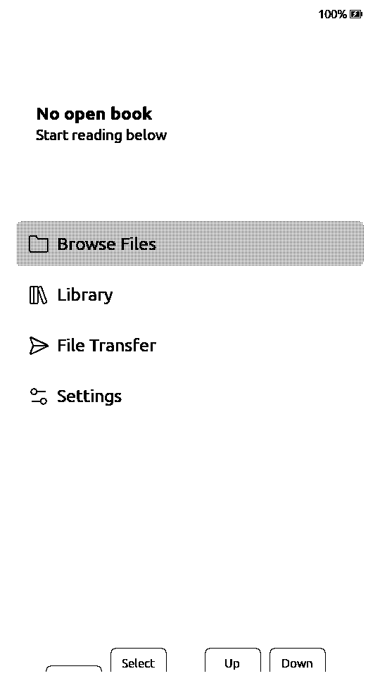
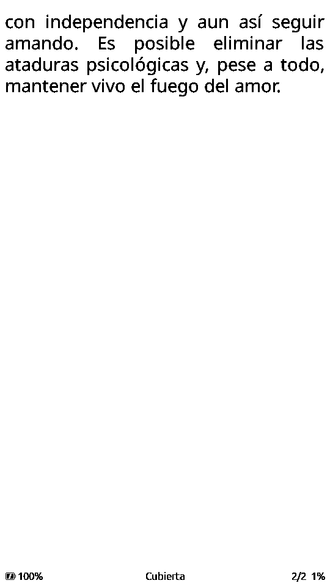

# 06 — Port notes and validation

**Languages:** [Español](06-porting.md) · **English** · [简体中文](06-porting.zh-CN.md) · [日本語](06-porting.ja.md)

## Changes from CrossPoint 2.0

Base commit: `fa17b9ca794c798d925734af9cce2bc3bff644ec` (develop, 2.0.0,
2026-11-12). `main` mirrors upstream; `paperdiy` is the fork. The
`freeink-sdk` SDK is vendored so the build is self-contained. The port is kept
in `patches/sdk.patch` + `patches/firmware.patch`.

### `freeink-sdk/libs/hardware/BoardConfig/include/BoardConfig.h`

- New `FREEINK_DEVICE_PAPERDIY` flag (0/1).
- New `Board::M5PaperDiy`.
- New `M5PAPER_DIY` profile:
  - 960×540, `LgfxEpd`, `DigitalTwoButton`.
  - SD SPI 39/40/38/47.
  - `up=GPIO4` (A), `down=GPIO3` (B).
  - no touch/RTC/IMU/audio/frontlight; battery via PM1.
- `FREEINK_DRIVER_LGFX_EPD` includes PaperDIY.
- `DEFAULT_DEVICE`, `selectDevice()` and `isPaperDiy()`.
- `MAX_FRAMEBUFFER_BYTES` includes the PaperDIY panel.
- `FREEINK_FB_PSRAM` includes PaperDIY (framebuffer in PSRAM).

### `freeink-sdk/libs/hardware/BoardConfig/include/M5Pm1.h`

- SDA/SCL = 41/42 for PaperDIY.
- `GPIO2` (EPD rail), `GPIO3` (CHG_STAT) and `REG_GPIO_IN`.

### `freeink-sdk/libs/display/FreeInkDisplay/src/driver/LgfxEpdDriver.cpp`

- `FREEINK_DEVICE_PAPERDIY` branch that uses `paperdiyLgfxConfig()`.

### `freeink-sdk/libs/hardware/BatteryMonitor/src/BatteryMonitor.cpp`

- `hasM5Pm1Backend()` includes `isPaperDiy()`; reads VBAT/VIN/VOUT, PWR_SRC and
  CHG_STAT (PM1 GPIO3) for the charge status.

### `freeink-sdk/libs/hardware/PowerManager/src/PowerManager.cpp`

- `armPowerButtonWakeup()`: PaperDIY arms `ext1` on GPIO3/4.
- `waitForPowerButtonRelease()`: waits for A and B to be released.
- `powerDownRailsForSleep()`: lowers PM1 GPIO2 after the panel sleeps.

### `freeink-sdk/libs/hardware/InputManager/src/InputManager.cpp`

- `BoardPaperDiy::ensureBooted()` at startup.
- `pollPowerButtonClicked()` becomes `BTN_POWER`; the PM1's physical button is
  now usable by the UI.

### `src/network/FirmwareBoardTag.cpp`

- `paperdiy` tag for OTA/build telemetry.

### `lib/hal/HalGPIO.cpp`

- `coldBootImpliesPowerButton()` includes PaperDIY.

### `lib/hal/HalPowerManager.cpp`

- On battery it asks the PM1 to shut down (`SYS_CMD 0xA1`); if USB keeps the
  board alive, it uses deep sleep with A/B wake.

### `src/main.cpp`

- PaperDIY enters the `AfterUSBPower` path (do not sleep in a loop with USB).
- The PM1 click with `Sleep`/`Ignore` action enters `enterDeepSleep()`.

### `src/network/OtaUpdater.cpp`

- Configurable `CROSSPOINT_OTA_RELEASES_URL`; tags with a `v` prefix are
  accepted.
- The `paperdiy` env pins this repo's releases and the asset name
  (`CROSSPOINT_OTA_ASSET_FORMAT`, `crosspoint-paperdiy-<version>-ota.bin`).

### `platformio.ini`

- `paperdiy` environment:
  - `esp32-s3-devkitc1-n16r8`, `qio_opi`.
  - `FREEINK_DEVICE_PAPERDIY=1`, `BOARD_HAS_PSRAM`.
  - `FREEINK_CAP_USB_MSC=1`, `FREEINK_CAP_BLE_HID_HOST=1`.
  - `BoardPaperDiy` + `M5GFX`.

### New `freeink-sdk/libs/hardware/BoardPaperDiy/`

- `BoardPaperDiyPins.h`
- `BoardPaperDiy.h/.cpp`:
  - `ensureBooted()`: PM1, CHG/DCDC, GPIO2/3, power button;
  - `setEpdPower()` / `prepareEpdPower()` / `powerDownEpdPower()`;
  - `pollPowerButtonClicked()`;
  - `powerOff()`.
- `PaperDiyLgfxConfig.cpp`
- `library.json`

## Build

```bash
make build
# or:
PLATFORMIO_CORE_DIR="$PWD/.platformio-core" pio run -e paperdiy
```

Result on the development machine (macOS, PlatformIO 6.1.19, pioarduino
55.03.311, Arduino-ESP32 3.3.11):

```
RAM:   33.9% (110,924 / 327,680 bytes)
Flash: 82.7% (5,422,747 / 6,553,600 bytes)
firmware.bin          5.2 MB
firmware.factory.bin  5.2 MB
```

### Environment problem found

The global `~/.platformio` had an old `framework-arduinoespressif32` (3.20017)
mixed with the 3.3.11 framework required by pioarduino. That produced errors
such as `Client.h: No such file`, `pins_arduino.h` or a `FRAMEWORK_DIR`
pointing to a non-existent `@src-...` directory. The reproducible fix is to use
an **isolated PlatformIO core**:

```bash
PLATFORMIO_CORE_DIR="$PWD/.platformio-core" pio run -e paperdiy
```

The `Makefile` already does this. `.platformio-core` is in `.gitignore`; it can
be deleted and will be rebuilt (it downloads ~5 GB the first time).

## Flash

### First install

1. Back up the original firmware:

```bash
esptool --chip esp32s3 --port /dev/cu.usbmodemXXXX \
  read_flash 0 0x1000000 paperdiy-original.bin
```

2. Enter download mode: hold power for ~10 s until the red LED blinks; the
   screen may freeze.

3. Full image:

```bash
esptool --chip esp32s3 --port /dev/cu.usbmodemXXXX \
  write_flash 0x0 .pio/build/paperdiy/firmware.factory.bin
```

### App update

```bash
esptool --chip esp32s3 --port /dev/cu.usbmodemXXXX \
  write_flash 0x10000 .pio/build/paperdiy/firmware.bin
```

or `make flash PORT=/dev/cu.usbmodemXXXX`.

## First hardware validation (2026-10-28)

- Flashed `firmware.factory.bin` at `0x0` over USB; hash verified.
- Correct boot: logs with ~129 KB free heap and ~6.3 MB free PSRAM.
- The UI looks **correct in portrait**; home with "No open book", Browse Files,
  Library, File Transfer and Settings. Battery at 100%.
- A/B respond. Short clicks are registered **on release** (`DigitalTwoButton`
  behavior, needed to distinguish a click from a long press). Still to decide
  whether to switch to "page on press".
- 8 GB FAT32 SD mounts after reboot; `Books/Amar-o-depender.epub` and
  `Books/Reconciliacion.epub` appear in Browse Files. The EPUB opens, pages and
  reads correctly.
- Wi-Fi and web UI work; books were uploaded through the web UI and opened from
  the reader.
- Validated later: OPDS, Calibre wireless, OTA, power/shutdown and wake by
  power. Pending at that time: KOReader Sync with credentials, general
  ghosting, sleep current, deep sleep with A/B wake and battery life.

Update (2026-11-04): after syncing to upstream `308cd522`, boot, Home, wake,
A/B navigation, battery and SD were validated again.

Update (2026-11-05): OPDS with Project Gutenberg (browse, download and read),
font-size changes and 96 page turns without memory leaks. A+B over USB on the
test device powered off via the PM1 and A did not wake it; power turned it on
preserving the page. Physical ghosting cannot be evaluated from the serial
capture; visual review after 24 pages showed no appreciable ghosting. The
page counter went from 1/35 to 1/50 when the section build completed.
Auto-sleep at 1 min with `Fondo = Portada` and `Modo = Ajustar` showed the
cover, and power woke it preserving the page.

Update (2026-11-06): automated long read over USB with 250+ page turns (spines
10→24, several chapters) without reboots or leaks. Free heap 120.6–120.8 KB and
PSRAM ~6.36 MB; transient heap low 81.7 KB. Full-page timings: `fast`
569–620 ms display (651–726 ms total) and clean `text` 1538–1542 ms
(1637–1651 ms total); prewarm 38–58 ms and B/W render 49–59 ms. `quality` is
unused by the port; a temporary `Half→quality` mapping measured 1538 ms, the
same as `text`, and the code was restored. `CMD:KEY` does not renew activity:
after 10 min the device auto-slept and USB disappeared; power woke it
preserving the page. For long tests set `Auto suspend = Never` or renew
activity. Physical ghosting review after the long read is still pending.





### Ghosting when opening the reader menu

First real-use finding: when going from a page to the reader menu, a faint
shadow of the previous text remained. The cause was that
`UiListActivity::render()` painted the full menu with `FAST_REFRESH`.

Fix: `EpubReaderMenuActivity` sets `cleanFirstRender`; the first menu paint uses
`HALF_REFRESH` (clean bank) and subsequent paints go back to `FAST_REFRESH`.
Verified on hardware: the menu is clean and navigation inside it stays fast.
The first paint may flicker a little more; that is expected.

If a shadow of the menu appears over the page when **closing** the menu, apply
the same treatment to the reader re-render.

### Page-turn ghosting

The raw-parallel ED047TC1 panel accumulates ghosting faster than the SPI
controllers CrossPoint was calibrated for. With text antialiasing, each page
sends **two** waveforms (B/W base + gray plane), so the default interval of 15
pages was equivalent to ~30 fast passes before cleaning.

First attempt (2026-10-31): enable `cleanBankNeedsFreshBackground` with a
no-drive LUT in `lutFastest`. On hardware it did not reduce ghosting and added
visible full refreshes, so it was reverted.

Current state (test): `lutFast`/`lutFastest` use the ED047TC1 AA waveform from
the LilyGo T5 S3 (same panel). It keeps the B/W base and the gray plane at the
same LUT offset, avoids the black flash of `lut_fast` and specifically pushes
the gray levels produced by antialiasing. The default interval is now **5
pages**, and a one-time migration moves the inherited 1 from the previous test
to 5; afterwards the reader's choice in
`Settings > Display > Refresh Frequency` is respected.

Pending validation during long reading sessions. If this LUT does not improve
ghosting, the next options are a custom `text` waveform or a periodic
`epd_quality` refresh.

### Battery, charging and PM1

The M5PM1 has no coulomb counter: it only exposes `VBAT` in mV. Charging is
done by an LGS4056H with `R11=2K`, i.e. 500 mA. With the original 140 mAh cell
that is ~3.6C; with a ~2000 mAh 604050 it is ~0.25C, much more reasonable.

Hardware measurement with the original cell and USB connected:

```
VBAT=4110 mV  VIN=5082 mV  PWR_SRC=5  CHG_STAT=high  PWR_CFG=0x03
```

The charger had already finished and the cell was at ~4.10 V, not 4.20 V.
`BatteryMonitor`'s generic curve assumed 4.20 V and showed 90%. A
`PAPERDIY_LIION_NOTCH_MV` curve was added with the same lower segment and
**4.10 V = 100%**. If the cell is changed to one that charges to 4.20 V, the
upper anchor must be recalibrated or the generic curve restored.

M5Stack ecosystem pieces are also integrated:

- `M5PM1::setBatteryLvp()`: protection threshold at 3.4 V (`REG_BATT_LVP`).
- `CHG_STAT` (PM1 GPIO3, active low) for the real charging icon.
- `VBAT`/`VIN` sampling in `About` and the boot log.
- References: `m5stack/M5PM1`, `m5stack/M5PaperDIY-UserDemo` and
  `m5stack/uiflow-micropython` (`m5pm1.py` driver).

### Partial refresh

The panel can update by regions without repainting the whole screen:

- `GfxRenderer::displayWindow(x, y, w, h)` receives logical coordinates, rotates
  them to panel memory, aligns x to 8 pixels and calls
  `HalDisplay::displayWindow`.
- `LgfxEpdDriver::displayWindow()` fills the 8-bit canvas from the framebuffer
  and does `pushImage(x, y, w, h)` on `Panel_EPD`; LovyanGFX refreshes only the
  written `_range_mod`.
- `OptionPopup` uses the partial path for the dialog and the button strip
  (which is always drawn in Portrait). It is active in Settings, File Browser,
  Library and the reader menu; activities that clear the screen
  (`ConfirmationActivity`, `ClearCacheActivity`) still use a full refresh.
- Pending: status/battery bar and a limit on partial refreshes before a full
  `epd_quality`, as M5Stack's UserDemo does.

### SD card detection

PaperDIY exposes `CARD_DET` on GPIO48, active low. `SdPins.detect` passes it to
`SDCardManager`:

- `isCardPresent()` reads the pin with a pull-up.
- `begin()` does not try to mount if there is no card.
- When booting without a card, `main` shows "Insert SD card" and waits;
  inserting it reboots to mount.
- At runtime, the main loop polls the pin every 500 ms; on insertion it calls
  `Storage.remount()`. On removal it does not force-unmount, to avoid
  invalidating open files; the next insertion re-probes the card.
- Verified (2026-11-04): removing it while reading shows “Insert SD card”; on
  reinsertion the device reboots, mounts the card and returns Home.

## Hardware validation checklist

Mark each item and note the result; this is the information still missing to
consider the port "stable".

| # | Test | Expected | Result |
|---|---|---|---|
| 1 | Boot | splash/UI on screen | |
| 2 | Rotation | landscape UI, not inverted | |
| 3 | Text | readable EPUB page, no severe ghosting | OK (28/10); no appreciable ghosting after 24 pages (05/11); 250+ pages without errors, physical review pending (06/11) |
| 4 | quality/text/fast/fastest refresh | acceptable times and quality | `fast` 569–620 ms, `text` 1538–1542 ms; `quality` ≈1538 ms with temporary mapping; `fastest` unused (06/11) |
| 5 | A/B short | move selection / page | |
| 6 | A/B long | back / confirm | |
| 7 | A+B | power event / sleep | |
| 8 | Battery | coherent % and mV; charging detected | |
| 9 | SD | mounts, lists books, cache | |
| 10 | Large EPUB | opens and pages without OOM | |
| 11 | TTF font on SD | can be selected | |
| 12 | Dictionary | indexes and looks up | |
| 13 | Wi-Fi | scan/join; web UI | |
| 14 | OPDS/Calibre | downloads a book | OPDS Gutenberg and Calibre OK (04–05/11) |
| 15 | Deep sleep | sleeps and wakes with A/B | A+B over USB powered off via PM1; A did not wake (05/11) |
| 16 | Sleep current | ideally < 0.5 mA | Pending |
| 17 | Wake | no accidental page turn | Power wakes and preserves the page; A does not wake after A+B (05/11) |
| 18 | OTA | updates without bricking | OK (04/11) |
| 19 | Recovery | download mode + factory bin | OK (04/11) |
| 20 | Battery life | hours of real reading | Pending |
| 21 | PM1 short power | delivers `BTN_POWER` and sleeps/powers off | OK (04/11) |
| 22 | Shutdown on battery | PM1 cuts power; a click turns it on | OK (04/11) |
| 23 | USB fallback | with USB, deep sleep and A/B wake | N/A: PM1 powered off over USB (05/11) |
| 24 | Fork OTA | does not install official firmware; own URL if published | |

## Risks and mitigations

| Risk | Mitigation |
|---|---|
| Wrong rotation | try `rotation=0` and `2` in `paperdiyLgfxConfig` |
| Ghosting | try `cleanBankNeedsFreshBackground`, LilyGo/PaperS3 LUTs, periodic full refresh |
| Panel does not turn on | check `ensureBooted()`, PM1 GPIO2, GPIO46, CHG/DCDC_EN |
| High sleep current | cut PM1 GPIO2, SD power, holds; measure |
| Wrong battery reading | check PM1 registers 0x20–0x27 and `PWR_SRC` 0x04 |
| Accidental wake | `waitForPowerButtonRelease` + save the first release |
| UI unusable with 2 buttons | remapping, shortcuts, BLE page turner, review dialogs |
| Flash full | `slim` build, optimize fonts/languages, enlarge app0 or reduce spiffs |
| CrossPoint 2.0 changes | pin the commit, keep the patch, build tests |
| Power no longer resets | `PAPERDIY_PM1_APP_POWER_BUTTON=0` restores the factory reset |

## Upstream

Support can be proposed to CrossPoint:

1. `freeink-sdk` changes go to the submodule/SDK.
2. `platformio.ini`, `FirmwareBoardTag.cpp` and docs changes go to the main
   repo.
3. The PaperDIY profile is small and fits the existing architecture; it is a
   good PR candidate.

The port is split into `patches/sdk.patch` (SDK base `6a208c0c`) and
`patches/firmware.patch` (CrossPoint base `fa17b9ca`). Generation and the sync
process are in [`10-fork-maintenance.md`](10-fork-maintenance.md).

## Status

- [x] Board profile.
- [x] Panel driver.
- [x] PM1 (rail, battery, CHG_STAT, shutdown).
- [x] PM1 power button as `BTN_POWER`.
- [x] Button wake; shutdown on battery and USB fallback.
- [x] Reproducible build and `main`/`paperdiy` fork.
- [x] Configurable OTA and `paperdiy` tag.
- [x] Basic hardware validation (2026-11-04).
- [x] OPDS, Calibre wireless and OTA (04–05/11/2026).
- [x] KOReader Sync with credentials (local KOSync server, 2026-11-06).
- [ ] Rotation/LUT/ghosting tuning.
- [ ] Current/battery-life measurement.
- [ ] Polished 2-button UX.
- [ ] Release.
