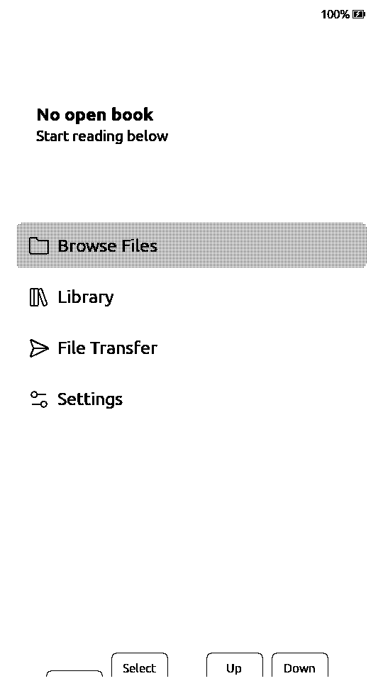
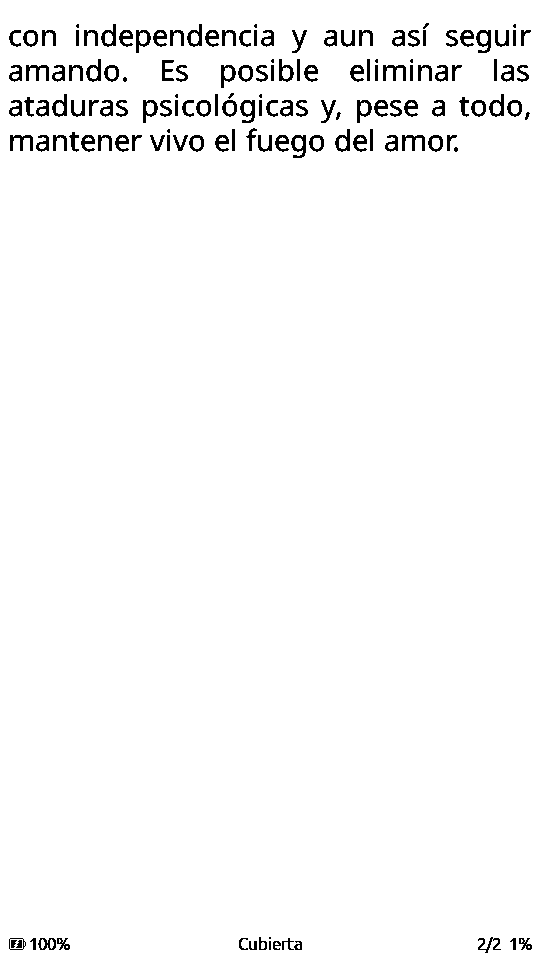

# 06 — 移植メモと検証

**言語：** [Español](06-porting.md) · [English](06-porting.en.md) · [简体中文](06-porting.zh-CN.md) · **日本語**

## CrossPoint 2.0 からの変更

ベースコミット：`818a1540069fd2c736c20f9dcad4b44542d4eae2`（develop、2.0.0、
2026-11-08）。`main` は上流のミラーで、`paperdiy` がフォークです。
`freeink-sdk` はビルドを自己完結させるため同梱しています。移植内容は
`patches/sdk.patch` + `patches/firmware.patch` にあります。

### `freeink-sdk/libs/hardware/BoardConfig/include/BoardConfig.h`

- 新しい `FREEINK_DEVICE_PAPERDIY` フラグ（0/1）。
- 新しい `Board::M5PaperDiy`。
- 新しい `M5PAPER_DIY` プロファイル：
  - 960×540、`LgfxEpd`、`DigitalTwoButton`。
  - SD SPI 39/40/38/47。
  - `up=GPIO4`（A）、`down=GPIO3`（B）。
  - タッチ/RTC/IMU/オーディオ/フロントライトなし。バッテリーは PM1 経由。
- `FREEINK_DRIVER_LGFX_EPD` に PaperDIY を含める。
- `DEFAULT_DEVICE`、`selectDevice()`、`isPaperDiy()`。
- `MAX_FRAMEBUFFER_BYTES` に PaperDIY パネルを含める。
- `FREEINK_FB_PSRAM` に PaperDIY を含める（フレームバッファを PSRAM に配置）。

### `freeink-sdk/libs/hardware/BoardConfig/include/M5Pm1.h`

- PaperDIY の SDA/SCL = 41/42。
- `GPIO2`（EPD レール）、`GPIO3`（CHG_STAT）、`REG_GPIO_IN`。

### `freeink-sdk/libs/display/FreeInkDisplay/src/driver/LgfxEpdDriver.cpp`

- `paperdiyLgfxConfig()` を使う `FREEINK_DEVICE_PAPERDIY` 分岐。

### `freeink-sdk/libs/hardware/BatteryMonitor/src/BatteryMonitor.cpp`

- `hasM5Pm1Backend()` に `isPaperDiy()` を含める。VBAT/VIN/VOUT、PWR_SRC、
  CHG_STAT（PM1 GPIO3）を読み、充電状態を取得。

### `freeink-sdk/libs/hardware/PowerManager/src/PowerManager.cpp`

- `armPowerButtonWakeup()`：PaperDIY は GPIO3/4 で `ext1` を設定。
- `waitForPowerButtonRelease()`：A と B が離されるまで待つ。
- `powerDownRailsForSleep()`：パネルスリープ後に PM1 GPIO2 を下げる。

### `freeink-sdk/libs/hardware/InputManager/src/InputManager.cpp`

- 起動時に `BoardPaperDiy::ensureBooted()`。
- `pollPowerButtonClicked()` を `BTN_POWER` に変換。PM1 の物理ボタンが UI
  から使えるようになる。

### `src/network/FirmwareBoardTag.cpp`

- OTA/ビルドテレメトリ用の `paperdiy` タグ。

### `lib/hal/HalGPIO.cpp`

- `coldBootImpliesPowerButton()` に PaperDIY を含める。

### `lib/hal/HalPowerManager.cpp`

- バッテリー時は PM1 にシャットダウンを要求（`SYS_CMD 0xA1`）。USB が基板を
  維持している場合はディープスリープし、A/B で復帰。

### `src/main.cpp`

- PaperDIY は `AfterUSBPower` パスに入る（USB 接続中にループでスリープしない）。
- `Sleep`/`Ignore` アクションの PM1 クリックは `enterDeepSleep()` に入る。

### `src/network/OtaUpdater.cpp`

- `CROSSPOINT_OTA_RELEASES_URL` を設定可能。`v` 接頭辞付きタグも受け付ける。
- 既定では公式リポジトリを指すが、`-paperdiy` アセットが存在しないため、
  外部ファームウェアをインストールすることはない。

### `platformio.ini`

- `paperdiy` 環境：
  - `esp32-s3-devkitc1-n16r8`、`qio_opi`。
  - `FREEINK_DEVICE_PAPERDIY=1`、`BOARD_HAS_PSRAM`。
  - `FREEINK_CAP_USB_MSC=1`、`FREEINK_CAP_BLE_HID_HOST=1`。
  - `BoardPaperDiy` + `M5GFX`。

### 新規 `freeink-sdk/libs/hardware/BoardPaperDiy/`

- `BoardPaperDiyPins.h`
- `BoardPaperDiy.h/.cpp`：
  - `ensureBooted()`：PM1、CHG/DCDC、GPIO2/3、電源ボタン；
  - `setEpdPower()` / `prepareEpdPower()` / `powerDownEpdPower()`；
  - `pollPowerButtonClicked()`；
  - `powerOff()`。
- `PaperDiyLgfxConfig.cpp`
- `library.json`

## ビルド

```bash
make build
# または：
PLATFORMIO_CORE_DIR="$PWD/.platformio-core" pio run -e paperdiy
```

開発マシンでの結果（macOS、PlatformIO 6.1.19、pioarduino 55.03.311、
Arduino-ESP32 3.3.11）：

```
RAM:   33.9% (111,076 / 327,680 bytes)
Flash: 81.6% (5,347,703 / 6,553,600 bytes)
firmware.bin          5.1 MB
firmware.factory.bin  5.2 MB
```

### 発生した環境問題

グローバルの `~/.platformio` に古い `framework-arduinoespressif32`（3.20017）
が残り、pioarduino が要求する 3.3.11 と混在していました。これにより
`Client.h: No such file`、`pins_arduino.h`、存在しない `@src-...` を指す
`FRAMEWORK_DIR` などのエラーが発生しました。再現性のある解決策は
**分離された PlatformIO core** を使うことです：

```bash
PLATFORMIO_CORE_DIR="$PWD/.platformio-core" pio run -e paperdiy
```

`Makefile` はすでにこのようにしています。`.platformio-core` は `.gitignore` に
あり、削除しても自動再構築されます（初回は約 5 GB をダウンロード）。

## 書き込み

### 初回インストール

1. 元のファームウェアをバックアップ：

```bash
esptool --chip esp32s3 --port /dev/cu.usbmodemXXXX \
  read_flash 0 0x1000000 paperdiy-original.bin
```

2. ダウンロードモードに入る：電源を約 10 秒長押しし、赤 LED が点滅するまで
   待ちます。画面が固まることがあります。

3. 完全イメージ：

```bash
esptool --chip esp32s3 --port /dev/cu.usbmodemXXXX \
  write_flash 0x0 .pio/build/paperdiy/firmware.factory.bin
```

### アプリ更新

```bash
esptool --chip esp32s3 --port /dev/cu.usbmodemXXXX \
  write_flash 0x10000 .pio/build/paperdiy/firmware.bin
```

または `make flash PORT=/dev/cu.usbmodemXXXX`。

## 初回ハードウェア検証（2026-10-28）

- USB 経由で `firmware.factory.bin` を `0x0` に書き込み。ハッシュ検証済み。
- 正常起動：ログで約 129 KB の空きヒープ、約 6.3 MB の空き PSRAM。
- UI は**縦向きで正しく表示**。ホームに「No open book」、Browse Files、
  Library、File Transfer、Settings。バッテリー 100%。
- A/B が反応。短押しは**離した時**に登録（`DigitalTwoButton` の動作で、
  クリックと長押しを区別するために必要）。「押した瞬間にページ送り」へ
  変更するかは未決定。
- 8 GB FAT32 SD が再起動後にマウント。`Books/Amar-o-depender.epub` と
  `Books/Reconciliacion.epub` が Browse Files に表示。EPUB は開いてページ
  送りも正常。
- Wi-Fi と Web UI が動作。Web UI から本をアップロードし、リーダーから開けた。
- 後日検証済み：OPDS、Calibre ワイヤレス、OTA、電源/シャットダウン、電源
  による復帰。当時の残りは KOReader Sync（認証情報が必要）、一般的な残像、
  スリープ電流、A/B 復帰付きディープスリープ、バッテリー駆動時間です。

更新（2026-11-04）：上流 `308cd522` への同期後、起動、ホーム、復帰、
A/B ナビゲーション、バッテリー、SD を再検証しました。

更新（2026-11-05）：Project Gutenberg の OPDS（閲覧、ダウンロード、読書）、
フォントサイズ変更、96 回のページ送りをメモリリークなしで検証。テスト機では
USB 接続中の A+B で PM1 が電源を切り、A では復帰しませんでした。電源ボタンで
ページを保持したまま復帰。物理的な残像はシリアルキャプチャでは評価できません
が、24 ページ後の目視確認では目立つ残像はありませんでした。セクション構築の
完了時にページ数が 1/35 から 1/50 に変わりました。自動スリープ 1 分、
`Fondo = Portada` + `Modo = Ajustar` で表紙を表示し、電源ボタンでページを
保持したまま復帰しました。

更新（2026-11-06）：USB 経由の自動長時間読書で 250+ 回のページ送り（spine
10→24、複数章）を再起動・リークなしで確認。空きヒープ 120.6–120.8 KB、
PSRAM 約 6.36 MB、ヒープ一時最小 81.7 KB。全ページ更新：`fast` は display
569–620 ms（合計 651–726 ms）、クリーンな `text` は 1538–1542 ms（合計
1637–1651 ms）。prewarm 38–58 ms、B/W 描画 49–59 ms。`quality` は移植版
では未使用。一時的に `Half→quality` へマッピングすると 1538 ms で `text`
と同じだったため、コードは元に戻しました。`CMD:KEY` は活動タイマーを更新
しないため、10 分後に自動スリープして USB が消えました。電源ボタンで
ページを保持したまま復帰。長時間テストでは `Auto suspensión = Nunca` に
するか活動を更新してください。長時間読書後の物理的な残像の目視確認は
未完了です。





### リーダーメニューを開くときの残像

最初の実機使用で見つかった問題：ページからリーダーメニューへ移ると、前の
テキストの薄い影が残りました。原因は `UiListActivity::render()` がメニュー
全体を `FAST_REFRESH` で描画していたことです。

修正：`EpubReaderMenuActivity` が `cleanFirstRender` を設定し、メニューの
最初の描画は `HALF_REFRESH`（クリーン bank）、以降は `FAST_REFRESH` に戻す。
実機で確認済み：メニューはきれいで、メニュー内のナビゲーションも高速な
ままです。最初の描画は少し多くちらつくことがありますが想定内です。

メニューを**閉じる**ときにページ上へメニューの影が出る場合は、リーダーの
再描画にも同じ処理を適用してください。

### ページ送りの残像

生のパラレル ED047TC1 パネルは、CrossPoint が校正対象とした SPI
コントローラーより残像が蓄積しやすいです。テキストのアンチエイリアスでは
各ページが**2 つ**の波形（B/W ベース + グレー平面）を送るため、既定の
15 ページ間隔はクリーニング前に約 30 回の高速パスに相当していました。

最初の試み（2026-10-31）：`lutFastest` で `cleanBankNeedsFreshBackground` と
no-drive LUT を有効化。実機では残像が減らず、目に見える全画面リフレッシュが
増えたため元に戻しました。

現在の状態（テスト中）：`lutFast`/`lutFastest` は LilyGo T5 S3（同じパネル）
の ED047TC1 AA 波形を使用。B/W ベースとグレー平面を同じ LUT オフセットに
保ち、`lut_fast` の黒フラッシュを避け、アンチエイリアスで生成される
グレーレベルを専用に駆動します。既定の間隔は **5 ページ**になり、一度だけ
のマイグレーションで以前のテスト由来の 1 を 5 に移行します。その後は
`Settings > Display > Refresh Frequency` で読者が選んだ値を尊重します。

長時間読書での検証はまだ必要です。この LUT で残像が改善しない場合、次は
独自の `text` 波形または定期的な `epd_quality` リフレッシュです。

### バッテリー、充電、PM1

M5PM1 にはクーロンカウンターがなく、mV 単位の `VBAT` のみを公開します。
充電は LGS4056H が行い、`R11=2K` で 500 mA。純正 140 mAh セルでは約 3.6C、
約 2000 mAh の 604050 では約 0.25C で、はるかに妥当です。

純正セルと USB 接続での実機測定：

```
VBAT=4110 mV  VIN=5082 mV  PWR_SRC=5  CHG_STAT=high  PWR_CFG=0x03
```

充電器はすでに終了しており、セルは 4.20 V ではなく約 4.10 V でした。
`BatteryMonitor` の汎用カーブは 4.20 V を前提にしていたため 90% と表示。
`PAPERDIY_LIION_NOTCH_MV` を追加し、下側セグメントは同じまま
**4.10 V = 100%** としました。4.20 V まで充電するセルに変更する場合は、
上限アンカーを再校正するか汎用カーブに戻す必要があります。

M5Stack エコシステムからも以下を統合：

- `M5PM1::setBatteryLvp()`：保護しきい値 3.4 V（`REG_BATT_LVP`）。
- `CHG_STAT`（PM1 GPIO3、アクティブ Low）で実際の充電アイコンを表示。
- `About` と起動ログで `VBAT`/`VIN` をサンプリング。
- 参考：`m5stack/M5PM1`、`m5stack/M5PaperDIY-UserDemo`、
  `m5stack/uiflow-micropython`（`m5pm1.py` ドライバー）。

### 部分リフレッシュ

画面全体を再描画せず、領域単位で更新できます：

- `GfxRenderer::displayWindow(x, y, w, h)` は論理座標を受け取り、パネル
  メモリへ回転し、x を 8 ピクセルに揃えて `HalDisplay::displayWindow` を
  呼びます。
- `LgfxEpdDriver::displayWindow()` はフレームバッファから 8 ビット
  キャンバスを埋め、`Panel_EPD` へ `pushImage(x, y, w, h)` します。
  LovyanGFX は書き込まれた `_range_mod` だけをリフレッシュします。
- `OptionPopup` はダイアログとボタン列（常に Portrait で描画）に部分
  リフレッシュを使います。Settings、File Browser、Library、リーダーメニュー
  で有効です。画面をクリアするアクティビティ
  （`ConfirmationActivity`、`ClearCacheActivity`）は全画面リフレッシュの
  ままです。
- 未完了：ステータス/バッテリーバー、および完全な `epd_quality` 前の部分
  リフレッシュ回数制限（M5Stack の UserDemo と同様）。

### SD カード検出

PaperDIY は GPIO48 に `CARD_DET` を公開し、アクティブ Low です。
`SdPins.detect` が `SDCardManager` へ渡します：

- `isCardPresent()` はプルアップ付きでピンを読む。
- カードがない場合、`begin()` はマウントを試みない。
- 起動時にカードがないと `main` は「Insert SD card」を表示して待機し、
  挿入すると再起動してマウントします。
- 実行中はメインループが 500 ms ごとにピンを確認し、挿入時に
  `Storage.remount()` を呼びます。取り外し時は開いているファイルを無効に
  しないよう強制アンマウントしません。次の挿入で再検出します。
- 検証済み（2026-11-04）：読書中に抜くと「Insert SD card」を表示し、再挿入
  すると再起動してマウントし、ホームに戻ります。

## ハードウェア検証チェックリスト

各項目をチェックし、結果を記録してください。移植を「安定」と判断するために
まだ不足している情報です。

| # | テスト | 期待結果 | 結果 |
|---|---|---|---|
| 1 | 起動 | 画面に splash/UI | |
| 2 | 回転 | 横向き UI、反転なし | |
| 3 | テキスト | EPUB ページが読め、重大な残像なし | OK (28/10)；24 ページ後も目立つ残像なし (05/11)；250+ ページでエラーなし、物理確認は未完了 (06/11) |
| 4 | quality/text/fast/fastest リフレッシュ | 時間と品質が許容範囲 | `fast` 569–620 ms、`text` 1538–1542 ms；一時マッピングで `quality` ≈1538 ms；`fastest` は未使用 (06/11) |
| 5 | A/B 短押し | 選択移動 / ページ送り | |
| 6 | A/B 長押し | 戻る / 決定 | |
| 7 | A+B | 電源イベント / スリープ | |
| 8 | バッテリー | % と mV が整合、充電検出 | |
| 9 | SD | マウント、本の一覧、キャッシュ | |
| 10 | 大きな EPUB | OOM なく開いてページ送り | |
| 11 | SD 上の TTF フォント | 選択できる | |
| 12 | 辞書 | 索引作成と検索 | |
| 13 | Wi-Fi | スキャン/接続、Web UI | |
| 14 | OPDS/Calibre | 本をダウンロード | OPDS Gutenberg と Calibre OK（04–05/11） |
| 15 | ディープスリープ | スリープし A/B で復帰 | USB 接続中の A+B で PM1 が電源オフ、A では復帰せず（05/11） |
| 16 | スリープ電流 | 理想的には < 0.5 mA | 保留 |
| 17 | 復帰 | 誤ったページ送りがない | 電源ボタンでページを保持して復帰、A+B 後の A では復帰せず（05/11） |
| 18 | OTA | 文鎮化せず更新 | OK（04/11） |
| 19 | 復旧 | ダウンロードモード + factory bin | OK（04/11） |
| 20 | バッテリー駆動時間 | 実際の読書時間 | 保留 |
| 21 | PM1 短押し電源 | `BTN_POWER` を発行しスリープ/電源オフ | OK（04/11） |
| 22 | バッテリー時シャットダウン | PM1 が電源を切り、クリックで起動 | OK（04/11） |
| 23 | USB フォールバック | USB 時はディープスリープし A/B で復帰 | 該当なし：USB 接続中に PM1 が電源オフ（05/11） |
| 24 | フォーク OTA | 公式ファームウェアを入れない。公開時は独自 URL | |

## リスクと対策

| リスク | 対策 |
|---|---|
| 回転が違う | `paperdiyLgfxConfig` で `rotation=0` と `2` を試す |
| 残像 | `cleanBankNeedsFreshBackground`、LilyGo/PaperS3 LUT、定期的な全画面リフレッシュを試す |
| パネルが点かない | `ensureBooted()`、PM1 GPIO2、GPIO46、CHG/DCDC_EN を確認 |
| スリープ電流が高い | PM1 GPIO2、SD 電源、holds を切る。実測 |
| バッテリー読み取りが違う | PM1 レジスタ 0x20–0x27 と `PWR_SRC` 0x04 を確認 |
| 誤復帰 | `waitForPowerButtonRelease` + 最初の release を保存 |
| 2 ボタンで UI が使いにくい | 再マッピング、ショートカット、BLE ページ送り、ダイアログ見直し |
| Flash 満杯 | `slim` ビルド、フォント/言語の最適化、app0 拡大または spiffs 削減 |
| CrossPoint 2.0 の変更 | コミットを固定、パッチを維持、ビルドテスト |
| 電源がリセットしなくなった | `PAPERDIY_PM1_APP_POWER_BUTTON=0` で出荷時リセットに戻す |

## 上流

CrossPoint へサポートを提案できます：

1. `freeink-sdk` の変更はサブモジュール/SDK へ。
2. `platformio.ini`、`FirmwareBoardTag.cpp`、ドキュメントの変更はメイン
   リポジトリへ。
3. PaperDIY プロファイルは小さく、既存アーキテクチャに合うため、PR の
   良い候補です。

移植は `patches/sdk.patch`（SDK ベース `fb7e926`）と
`patches/firmware.patch`（CrossPoint ベース `818a1540`）に分かれています。
生成と同期の手順は [`10-fork-maintenance.md`](10-fork-maintenance.md) を
参照してください。

## 状態

- [x] ボードプロファイル。
- [x] パネルドライバー。
- [x] PM1（レール、バッテリー、CHG_STAT、シャットダウン）。
- [x] PM1 電源ボタンを `BTN_POWER` として扱う。
- [x] ボタン復帰。バッテリー時シャットダウンと USB フォールバック。
- [x] 再現性のあるビルドと `main`/`paperdiy` フォーク。
- [x] 設定可能な OTA と `paperdiy` タグ。
- [x] 基本的なハードウェア検証（2026-11-04）。
- [x] OPDS、Calibre ワイヤレス、OTA（2026-11-04～05）。
- [x] KOReader Sync（認証情報が必要、ローカル KOSync サーバーで 2026-11-06 に検証）。
- [ ] 回転/LUT/残像の調整。
- [ ] 電流/バッテリー駆動時間の測定。
- [ ] 2 ボタン UX の磨き込み。
- [ ] リリース。
