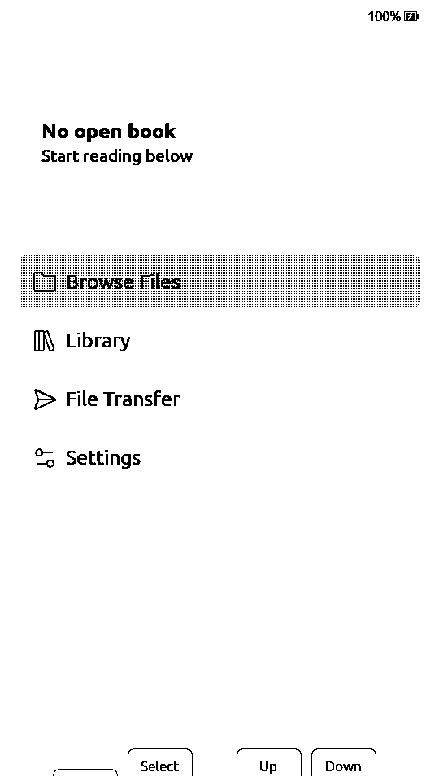
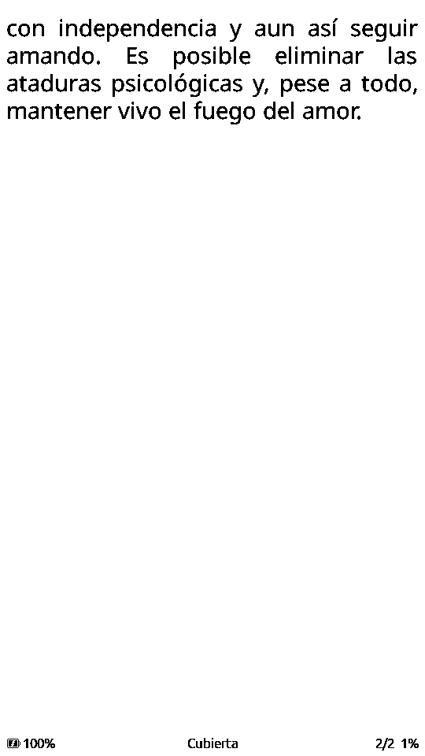

# 06 — Notas del port y validación

## Cambios respecto a CrossPoint 2.0

Commit base: `31dc683f9ad54d85a35a1eeb698470bb6da69224` (develop, 2.0.0,
2026-10-28). `main` es el espejo de upstream; `paperdiy` es el fork. El SDK
`freeink-sdk` está vendorizado para que el build sea autocontenido. El port se
mantiene en `patches/sdk.patch` + `patches/firmware.patch`.

### `freeink-sdk/libs/hardware/BoardConfig/include/BoardConfig.h`

- Nuevo flag `FREEINK_DEVICE_PAPERDIY` (0/1).
- Nuevo `Board::M5PaperDiy`.
- Nuevo perfil `M5PAPER_DIY`:
  - 960×540, `LgfxEpd`, `DigitalTwoButton`.
  - SD SPI 39/40/38/47.
  - `up=GPIO4` (A), `down=GPIO3` (B).
  - sin táctil/RTC/IMU/audio/frontlight; batería por PM1.
- `FREEINK_DRIVER_LGFX_EPD` incluye PaperDIY.
- `DEFAULT_DEVICE`, `selectDevice()` y `isPaperDiy()`.
- `MAX_FRAMEBUFFER_BYTES` incluye el panel de PaperDIY.
- `FREEINK_FB_PSRAM` incluye PaperDIY (framebuffer en PSRAM).

### `freeink-sdk/libs/hardware/BoardConfig/include/M5Pm1.h`

- SDA/SCL = 41/42 para PaperDIY.
- `GPIO2` (rail EPD), `GPIO3` (CHG_STAT) y `REG_GPIO_IN`.

### `freeink-sdk/libs/display/FreeInkDisplay/src/driver/LgfxEpdDriver.cpp`

- Rama `FREEINK_DEVICE_PAPERDIY` que usa `paperdiyLgfxConfig()`.

### `freeink-sdk/libs/hardware/BatteryMonitor/src/BatteryMonitor.cpp`

- `hasM5Pm1Backend()` incluye `isPaperDiy()`; lee VBAT/VIN/VOUT, PWR_SRC y
  CHG_STAT (PM1 GPIO3) para el estado de carga.

### `freeink-sdk/libs/hardware/PowerManager/src/PowerManager.cpp`

- `armPowerButtonWakeup()`: PaperDIY arma `ext1` en GPIO3/4.
- `waitForPowerButtonRelease()`: espera a que A y B se suelten.
- `powerDownRailsForSleep()`: baja PM1 GPIO2 tras el sleep del panel.

### `freeink-sdk/libs/hardware/InputManager/src/InputManager.cpp`

- `BoardPaperDiy::ensureBooted()` al iniciar.
- `pollPowerButtonClicked()` se convierte en `BTN_POWER`; el botón físico del
  PM1 ya es usable por la UI.

### `src/network/FirmwareBoardTag.cpp`

- Tag `paperdiy` para OTA/telemetría de build.

### `lib/hal/HalGPIO.cpp`

- `coldBootImpliesPowerButton()` incluye PaperDIY.

### `lib/hal/HalPowerManager.cpp`

- En batería pide shutdown al PM1 (`SYS_CMD 0xA1`); si USB mantiene la placa,
  hace deep sleep con wake por A/B.

### `src/main.cpp`

- PaperDIY entra en el path `AfterUSBPower` (no dormir en bucle con USB).
- El clic del PM1 con acción `Sleep`/`Ignore` entra en `enterDeepSleep()`.

### `src/network/OtaUpdater.cpp`

- `CROSSPOINT_OTA_RELEASES_URL` configurable; tags con prefijo `v` aceptados.
- Por defecto apunta al repo oficial, pero no existe asset `-paperdiy`, así que
  no instala firmware ajeno.

### `platformio.ini`

- Env `paperdiy`:
  - `esp32-s3-devkitc1-n16r8`, `qio_opi`.
  - `FREEINK_DEVICE_PAPERDIY=1`, `BOARD_HAS_PSRAM`.
  - `FREEINK_CAP_USB_MSC=1`, `FREEINK_CAP_BLE_HID_HOST=1`.
  - `BoardPaperDiy` + `M5GFX`.

### Nuevo `freeink-sdk/libs/hardware/BoardPaperDiy/`

- `BoardPaperDiyPins.h`
- `BoardPaperDiy.h/.cpp`:
  - `ensureBooted()`: PM1, CHG/DCDC, GPIO2/3, botón power;
  - `setEpdPower()` / `prepareEpdPower()` / `powerDownEpdPower()`;
  - `pollPowerButtonClicked()`;
  - `powerOff()`.
- `PaperDiyLgfxConfig.cpp`
- `library.json`

## Build

```bash
make build
# o:
PLATFORMIO_CORE_DIR="$PWD/.platformio-core" pio run -e paperdiy
```

Resultado en la máquina de desarrollo (macOS, PlatformIO 6.1.19, pioarduino
55.03.311, Arduino-ESP32 3.3.11):

```
RAM:   33.9% (111.076 / 327.680 bytes)
Flash: 81.6% (5.347.703 / 6.553.600 bytes)
firmware.bin          5,1 MB
firmware.factory.bin  5,2 MB
```

### Problema de entorno encontrado

El `~/.platformio` global tenía un `framework-arduinoespressif32` viejo
(3.20017) mezclado con el framework 3.3.11 que pide pioarduino. Eso producía
errores como `Client.h: No such file`, `pins_arduino.h` o un `FRAMEWORK_DIR`
apuntando a un directorio `@src-...` inexistente. La solución reproducible es
usar un **core de PlatformIO aislado**:

```bash
PLATFORMIO_CORE_DIR="$PWD/.platformio-core" pio run -e paperdiy
```

El `Makefile` ya lo hace. `.platformio-core` está en `.gitignore`; se puede
borrar y se reconstruye solo (descarga ~5 GB la primera vez).

## Flash

### Primera instalación

1. Backup del firmware original:

```bash
esptool --chip esp32s3 --port /dev/cu.usbmodemXXXX \
  read_flash 0 0x1000000 paperdiy-original.bin
```

2. Entrar en download mode: mantener power ~2 s hasta que el LED rojo
   parpadee.

3. Imagen completa:

```bash
esptool --chip esp32s3 --port /dev/cu.usbmodemXXXX \
  write_flash 0x0 .pio/build/paperdiy/firmware.factory.bin
```

### Actualización de la app

```bash
esptool --chip esp32s3 --port /dev/cu.usbmodemXXXX \
  write_flash 0x10000 .pio/build/paperdiy/firmware.bin
```

o `make flash PORT=/dev/cu.usbmodemXXXX`.

## Primera validación en hardware (28/10/2026)

- Flash de `firmware.factory.bin` en `0x0` por USB; hash verificado.
- Arranque correcto: logs con ~129 KB de heap libre y ~6,3 MB de PSRAM libre.
- La UI se ve **correcta en vertical**; home con “No open book”, Browse Files,
  Library, File Transfer y Settings. Batería al 100 %.
- A/B responden. Los clics cortos se registran **al soltar** (comportamiento
  de `DigitalTwoButton`, necesario para distinguir el clic de la pulsación
  larga). Pendiente decidir si se cambia a “page on press”.
- SD de 8 GB FAT32 monta tras reiniciar; `Books/Amar-o-depender.epub` y
  `Books/Reconciliacion.epub` aparecen en Browse Files. El EPUB abre, pagina y
  se lee correctamente.
- Wi-Fi y web UI funcionan; se han subido libros por la interfaz web y se han
  abierto desde el lector.
- Pendiente: OPDS, Calibre/KOReader Sync, ghosting general, consumo en sleep,
  botón power/shutdown, wake y OTA.





### Ghosting al abrir el menú del lector

Primer hallazgo de uso real: al pasar de una página al menú del lector quedaba
una sombra tenue del texto anterior. La causa era que `UiListActivity::render()`
pintaba el menú completo con `FAST_REFRESH`.

Solución: `EpubReaderMenuActivity` marca `cleanFirstRender`; la primera pintada
del menú usa `HALF_REFRESH` (banco limpio) y las siguientes vuelven a
`FAST_REFRESH`. Verificado en hardware: el menú queda limpio y la navegación
dentro de él sigue siendo rápida. El primer pintado puede parpadear algo más,
es esperado.

Si al **cerrar** el menú aparece sombra del menú sobre la página, aplicar el
mismo tratamiento al re-render del lector.

### Ghosting al pasar páginas

El panel ED047TC1 en modo paralelo crudo acumula ghosting más rápido que los
controladores SPI para los que se calibró CrossPoint. Con antialiasing de
texto cada página envía **dos** waveforms (base B/W + plano de grises), así
que el intervalo por defecto de 15 páginas equivalía a ~30 pasadas rápidas
antes del limpiado.

Primer intento (31/10/2026): activar `cleanBankNeedsFreshBackground` con una
LUT no-drive en `lutFastest`. En hardware no redujo el ghosting y añadía
refrescos completos visibles, así que se revirtió.

Estado actual (prueba): `lutFast`/`lutFastest` usan la waveform AA de ED047TC1
del LilyGo T5 S3 (mismo panel). Mantiene la base B/W y el plano de grises en
el mismo offset de LUT, evita el flash negro de `lut_fast` y empuja de forma
específica los niveles grises que produce el antialiasing. El intervalo por
defecto pasa a **5 páginas** y una migración única mueve a 5 el 1 heredado de
la prueba anterior; después se respeta lo que elija el lector en
`Settings > Display > Refresh Frequency`.

Pendiente de validar en lectura prolongada. Si esta LUT no mejora el
ghosting, las siguientes opciones son una waveform `text` propia o un
refresco `epd_quality` periódico.

## Checklist de validación en hardware

Marca cada punto y anota el resultado; es la información que falta para
considerar el port "estable".

| # | Prueba | Esperado | Resultado |
|---|---|---|---|
| 1 | Arranque | splash/UI en pantalla | |
| 2 | Rotación | UI en horizontal, no invertida | |
| 3 | Texto | página EPUB legible, sin ghosting grave | |
| 4 | Refresco quality/text/fast/fastest | tiempos y calidad aceptables | |
| 5 | A/B cortos | mover selección / página | |
| 6 | A/B largos | back / confirm | |
| 7 | A+B | evento power / dormir | |
| 8 | Batería | % y mV coherentes; carga detectada | |
| 9 | SD | monta, lista libros, caché | |
| 10 | EPUB grande | abre y pagina sin OOM | |
| 11 | Fuente TTF en SD | se puede seleccionar | |
| 12 | Diccionario | indexa y busca | |
| 13 | Wi-Fi | scan/join; web UI | |
| 14 | OPDS/Calibre | descarga un libro | |
| 15 | Deep sleep | duerme y despierta con A/B | |
| 16 | Consumo sleep | < 0,5 mA idealmente | |
| 17 | Wake | no hace page turn accidental | |
| 18 | OTA | actualiza sin brick | |
| 19 | Recuperación | download mode + factory bin | |
| 20 | Autonomía | horas de lectura reales | |
| 21 | Power PM1 corto | entrega `BTN_POWER` y duerme/apaga | |
| 22 | Shutdown en batería | el PM1 corta y un clic enciende | |
| 23 | Fallback USB | con USB, deep sleep y wake A/B | |
| 24 | OTA fork | no instala firmware oficial; URL propia si se publica | |

## Riesgos y mitigaciones

| Riesgo | Mitigación |
|---|---|
| Rotación incorrecta | probar `rotation=0` y `2` en `paperdiyLgfxConfig` |
| Ghosting | probar `cleanBankNeedsFreshBackground`, LUTs de LilyGo/PaperS3, refresco completo periódico |
| Panel no enciende | verificar `ensureBooted()`, PM1 GPIO2, GPIO46, CHG/DCDC_EN |
| Consumo alto en sleep | cortar PM1 GPIO2, SD power, holds; medir |
| Batería mal leída | verificar registros PM1 0x20–0x27 y `PWR_SRC` 0x04 |
| Wake accidental | `waitForPowerButtonRelease` + guardar el primer release |
| UI injugable con 2 botones | remapeo, atajos, BLE page turner, revisar diálogos |
| Flash lleno | build `slim`, optimizar fuentes/idiomas, ampliar app0 o reducir spiffs |
| CrossPoint 2.0 cambia | fijar commit, mantener patch, tests de build |
| El power deja de resetear | `PAPERDIY_PM1_APP_POWER_BUTTON=0` restaura el reset de fábrica |

## Upstream

El soporte se puede proponer a CrossPoint:

1. Los cambios de `freeink-sdk` van al submódulo/SDK.
2. Los cambios de `platformio.ini`, `FirmwareBoardTag.cpp` y la doc van al repo
   principal.
3. El perfil PaperDIY es pequeño y encaja con la arquitectura existente; es un
   buen candidato a PR.

El port está separado en `patches/sdk.patch` (base SDK `44427f8`) y
`patches/firmware.patch` (base CrossPoint `31dc683`). La generación y el
proceso de sync están en
[`10-fork-maintenance.md`](10-fork-maintenance.md).

## Estado

- [x] Perfil de placa.
- [x] Driver de panel.
- [x] PM1 (rail, batería, CHG_STAT, shutdown).
- [x] Botón power del PM1 como `BTN_POWER`.
- [x] Wake por botones; shutdown en batería y fallback USB.
- [x] Build reproducible y fork `main`/`paperdiy`.
- [x] OTA configurable y tag `paperdiy`.
- [ ] Validación en hardware.
- [ ] Ajuste de rotación/LUT/ghosting.
- [ ] Medición de consumo/autonomía.
- [ ] UX de 2 botones pulida.
- [ ] Release.
