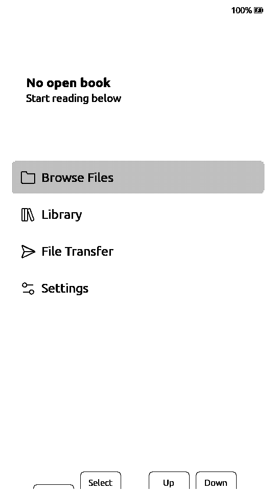
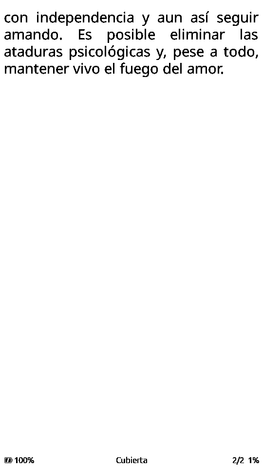

# 06 — 移植笔记与验证

**语言：** [Español](06-porting.md) · [English](06-porting.en.md) · **简体中文** · [日本語](06-porting.ja.md)

## 相对 CrossPoint 2.0 的改动

基础提交：`308cd522155ec11c3f62e346a1a961facd3dad80`（develop，2.0.0，
2026-11-03）。`main` 是上游镜像；`paperdiy` 是分支。`freeink-sdk` 已内置，
使构建自包含。移植修改保存在 `patches/sdk.patch` + `patches/firmware.patch`。

### `freeink-sdk/libs/hardware/BoardConfig/include/BoardConfig.h`

- 新增 `FREEINK_DEVICE_PAPERDIY` 标志（0/1）。
- 新增 `Board::M5PaperDiy`。
- 新增 `M5PAPER_DIY` 配置：
  - 960×540，`LgfxEpd`，`DigitalTwoButton`。
  - SD SPI 39/40/38/47。
  - `up=GPIO4`（A），`down=GPIO3`（B）。
  - 无触摸/RTC/IMU/音频/前置灯；电池由 PM1 管理。
- `FREEINK_DRIVER_LGFX_EPD` 包含 PaperDIY。
- `DEFAULT_DEVICE`、`selectDevice()` 和 `isPaperDiy()`。
- `MAX_FRAMEBUFFER_BYTES` 包含 PaperDIY 屏幕。
- `FREEINK_FB_PSRAM` 包含 PaperDIY（帧缓冲位于 PSRAM）。

### `freeink-sdk/libs/hardware/BoardConfig/include/M5Pm1.h`

- PaperDIY 使用 SDA/SCL = 41/42。
- `GPIO2`（EPD 电源轨）、`GPIO3`（CHG_STAT）和 `REG_GPIO_IN`。

### `freeink-sdk/libs/display/FreeInkDisplay/src/driver/LgfxEpdDriver.cpp`

- 增加 `FREEINK_DEVICE_PAPERDIY` 分支，使用 `paperdiyLgfxConfig()`。

### `freeink-sdk/libs/hardware/BatteryMonitor/src/BatteryMonitor.cpp`

- `hasM5Pm1Backend()` 包含 `isPaperDiy()`；读取 VBAT/VIN/VOUT、PWR_SRC 和
  CHG_STAT（PM1 GPIO3）作为充电状态。

### `freeink-sdk/libs/hardware/PowerManager/src/PowerManager.cpp`

- `armPowerButtonWakeup()`：PaperDIY 在 GPIO3/4 上配置 `ext1`。
- `waitForPowerButtonRelease()`：等待 A 和 B 松开。
- `powerDownRailsForSleep()`：屏幕休眠后拉低 PM1 GPIO2。

### `freeink-sdk/libs/hardware/InputManager/src/InputManager.cpp`

- 启动时调用 `BoardPaperDiy::ensureBooted()`。
- `pollPowerButtonClicked()` 转换为 `BTN_POWER`；PM1 的物理按键现在可供 UI
  使用。

### `src/network/FirmwareBoardTag.cpp`

- 用于 OTA/构建遥测的 `paperdiy` 标签。

### `lib/hal/HalGPIO.cpp`

- `coldBootImpliesPowerButton()` 包含 PaperDIY。

### `lib/hal/HalPowerManager.cpp`

- 电池模式下请求 PM1 关机（`SYS_CMD 0xA1`）；如果 USB 保持供电，则使用
  深度休眠并通过 A/B 唤醒。

### `src/main.cpp`

- PaperDIY 进入 `AfterUSBPower` 路径（不要在有 USB 时循环休眠）。
- PM1 点击在 `Sleep`/`Ignore` 动作下进入 `enterDeepSleep()`。

### `src/network/OtaUpdater.cpp`

- 可配置 `CROSSPOINT_OTA_RELEASES_URL`；接受带 `v` 前缀的标签。
- 默认指向官方仓库，但不存在 `-paperdiy` 资源，因此不会安装外部固件。

### `platformio.ini`

- `paperdiy` 环境：
  - `esp32-s3-devkitc1-n16r8`，`qio_opi`。
  - `FREEINK_DEVICE_PAPERDIY=1`，`BOARD_HAS_PSRAM`。
  - `FREEINK_CAP_USB_MSC=1`，`FREEINK_CAP_BLE_HID_HOST=1`。
  - `BoardPaperDiy` + `M5GFX`。

### 新增 `freeink-sdk/libs/hardware/BoardPaperDiy/`

- `BoardPaperDiyPins.h`
- `BoardPaperDiy.h/.cpp`：
  - `ensureBooted()`：PM1、CHG/DCDC、GPIO2/3、电源键；
  - `setEpdPower()` / `prepareEpdPower()` / `powerDownEpdPower()`；
  - `pollPowerButtonClicked()`；
  - `powerOff()`。
- `PaperDiyLgfxConfig.cpp`
- `library.json`

## 编译

```bash
make build
# 或：
PLATFORMIO_CORE_DIR="$PWD/.platformio-core" pio run -e paperdiy
```

开发机上的结果（macOS、PlatformIO 6.1.19、pioarduino 55.03.311、
Arduino-ESP32 3.3.11）：

```
RAM:   33.9% (111,076 / 327,680 bytes)
Flash: 81.6% (5,347,703 / 6,553,600 bytes)
firmware.bin          5.1 MB
firmware.factory.bin  5.2 MB
```

### 遇到的环境问题

全局 `~/.platformio` 中有旧的 `framework-arduinoespressif32`（3.20017），
与 pioarduino 需要的 3.3.11 混在一起。这会导致
`Client.h: No such file`、`pins_arduino.h` 或 `FRAMEWORK_DIR` 指向不存在的
`@src-...` 目录。可复现的解决方法是使用**隔离的 PlatformIO core**：

```bash
PLATFORMIO_CORE_DIR="$PWD/.platformio-core" pio run -e paperdiy
```

`Makefile` 已经这样做了。`.platformio-core` 在 `.gitignore` 中；可以删除，
它会自动重建（首次下载约 5 GB）。

## 烧录

### 首次安装

1. 备份原始固件：

```bash
esptool --chip esp32s3 --port /dev/cu.usbmodemXXXX \
  read_flash 0 0x1000000 paperdiy-original.bin
```

2. 进入下载模式：长按电源约 10 秒，直到红色 LED 闪烁；屏幕可能冻结。

3. 完整镜像：

```bash
esptool --chip esp32s3 --port /dev/cu.usbmodemXXXX \
  write_flash 0x0 .pio/build/paperdiy/firmware.factory.bin
```

### 应用更新

```bash
esptool --chip esp32s3 --port /dev/cu.usbmodemXXXX \
  write_flash 0x10000 .pio/build/paperdiy/firmware.bin
```

或 `make flash PORT=/dev/cu.usbmodemXXXX`。

## 首次硬件验证（2026-10-28）

- 通过 USB 在 `0x0` 烧录 `firmware.factory.bin`；哈希校验通过。
- 启动正常：日志显示约 129 KB 可用 heap、约 6.3 MB 可用 PSRAM。
- UI 在**竖屏下显示正确**；主页显示“No open book”、Browse Files、
  Library、File Transfer 和 Settings。电池 100%。
- A/B 有响应。短按在**松开**时触发（`DigitalTwoButton` 行为，用于区分
  短按和长按）。是否改为“按下即翻页”仍待决定。
- 8 GB FAT32 SD 卡重启后挂载；`Books/Amar-o-depender.epub` 和
  `Books/Reconciliacion.epub` 出现在 Browse Files 中。EPUB 可以打开、翻页
  并正常阅读。
- Wi-Fi 和网页界面正常；已通过网页界面上传图书并从阅读器打开。
- 后续已验证：OPDS、Calibre 无线传输、OTA、电源键/关机和电源键唤醒。
  仍待完成：需要凭据的 KOReader Sync、一般残影、休眠电流、A/B 唤醒的
  深度休眠和续航。

更新（2026-11-04）：同步到上游 `308cd522` 后，再次验证了启动、主页、唤醒、
A/B 导航、电池和 SD。

更新（2026-11-05）：Project Gutenberg OPDS（浏览、下载和阅读）、字号修改
和 96 次翻页均无内存泄漏。测试机在 USB 连接时 A+B 通过 PM1 关机，A 无法
唤醒；电源键开机并保留页面。串口截图无法评估物理残影；24 页后的目视
检查没有明显残影。章节构建完成时页码从 1/35 变为 1/50。自动休眠 1 分钟、
`Fondo = Portada` + `Modo = Ajustar` 显示封面，电源键唤醒并保留页面。

更新（2026-11-06）：通过 USB 自动长时间阅读，250+ 次翻页（spine 10→24，
多个章节）无重启、无泄漏。空闲堆 120.6–120.8 KB，PSRAM 约 6.36 MB；堆瞬时
最低 81.7 KB。整页刷新：`fast` display 569–620 ms（总计 651–726 ms），
干净 `text` 1538–1542 ms（总计 1637–1651 ms）；prewarm 38–58 ms，B/W
渲染 49–59 ms。移植未使用 `quality`；临时将 `Half→quality` 映射后测得
1538 ms，与 `text` 相同，之后已恢复代码。`CMD:KEY` 不会刷新活动计时：
10 分钟后设备自动休眠且 USB 消失；电源键唤醒并保留页面。长时间测试请设置
`Auto suspensión = Nunca` 或刷新活动。长时间阅读后的物理残影目视检查仍待
完成。





### 打开阅读器菜单时的残影

首次真实使用发现：从页面进入阅读器菜单时，会残留上一页文字的淡影。原因是
`UiListActivity::render()` 用 `FAST_REFRESH` 绘制整个菜单。

解决方法：`EpubReaderMenuActivity` 设置 `cleanFirstRender`；菜单第一次绘制
使用 `HALF_REFRESH`（干净 bank），后续绘制恢复 `FAST_REFRESH`。已在硬件
验证：菜单干净，菜单内导航仍然快速。第一次绘制可能闪烁稍多，这是预期行为。

如果**关闭**菜单时页面上出现菜单残影，需要对阅读器重新渲染应用同样的处理。

### 翻页残影

原始并行模式的 ED047TC1 面板比 CrossPoint 校准的 SPI 控制器更容易积累
残影。文字抗锯齿使每页发送**两个**波形（黑白基础 + 灰度平面），因此默认
15 页的间隔相当于约 30 次快速扫描后才清理。

第一次尝试（2026-10-31）：在 `lutFastest` 中启用
`cleanBankNeedsFreshBackground` 和 no-drive LUT。硬件上没有减少残影，还
增加了可见的整屏刷新，因此已回退。

当前状态（测试中）：`lutFast`/`lutFastest` 使用 LilyGo T5 S3（同款面板）
的 ED047TC1 AA 波形。它让黑白基础和灰度平面保持相同的 LUT 偏移，避免
`lut_fast` 的黑闪，并针对抗锯齿产生的灰度级别进行专门驱动。默认间隔改为
**5 页**，一次性迁移会把之前测试遗留的 1 改为 5；之后尊重阅读器在
`Settings > Display > Refresh Frequency` 中的选择。

仍需在长时间阅读中验证。如果这个 LUT 不能改善残影，下一步是自定义
`text` 波形或周期性 `epd_quality` 刷新。

### 电池、充电与 PM1

M5PM1 没有库仑计：只暴露 mV 单位的 `VBAT`。充电由 LGS4056H 完成，
`R11=2K`，即 500 mA。原装 140 mAh 电池约为 3.6C；约 2000 mAh 的 604050
约为 0.25C，合理得多。

使用原装电池并连接 USB 的硬件测量：

```
VBAT=4110 mV  VIN=5082 mV  PWR_SRC=5  CHG_STAT=high  PWR_CFG=0x03
```

充电器已经结束，电池约为 4.10 V，而不是 4.20 V。`BatteryMonitor` 的通用
曲线按 4.20 V 计算，显示 90%。新增 `PAPERDIY_LIION_NOTCH_MV`，保留相同的
下段并将 **4.10 V = 100%**。如果更换为充到 4.20 V 的电池，需要重新校准
上限锚点或恢复通用曲线。

还集成了 M5Stack 生态中的：

- `M5PM1::setBatteryLvp()`：保护阈值 3.4 V（`REG_BATT_LVP`）。
- `CHG_STAT`（PM1 GPIO3，低电平有效）用于真实充电图标。
- 在 `About` 和启动日志中采样 `VBAT`/`VIN`。
- 参考：`m5stack/M5PM1`、`m5stack/M5PaperDIY-UserDemo` 和
  `m5stack/uiflow-micropython`（`m5pm1.py` 驱动）。

### 部分刷新

屏幕可以按区域更新，而无需重绘整个屏幕：

- `GfxRenderer::displayWindow(x, y, w, h)` 接收逻辑坐标，旋转到面板内存，
  将 x 对齐到 8 像素，并调用 `HalDisplay::displayWindow`。
- `LgfxEpdDriver::displayWindow()` 从帧缓冲填充 8 位画布，并对
  `Panel_EPD` 执行 `pushImage(x, y, w, h)`；LovyanGFX 只刷新写入的
  `_range_mod`。
- `OptionPopup` 对对话框和按钮条（始终以 Portrait 绘制）使用部分刷新。
  已用于 Settings、File Browser、Library 和阅读器菜单；会清屏的活动
  （`ConfirmationActivity`、`ClearCacheActivity`）仍使用完整刷新。
- 待完成：状态栏/电池栏，以及在完整 `epd_quality` 前限制部分刷新次数，
  类似 M5Stack 的 UserDemo。

### SD 卡检测

PaperDIY 在 GPIO48 上提供 `CARD_DET`，低电平有效。`SdPins.detect` 将其传给
`SDCardManager`：

- `isCardPresent()` 使用上拉读取引脚。
- 没有卡时 `begin()` 不会尝试挂载。
- 启动时没有卡，`main` 显示“Insert SD card”并等待；插入后重启以挂载。
- 运行时主循环每 500 ms 查询引脚；插入时调用 `Storage.remount()`。移除时
  不会强制卸载，以免使已打开的文件失效；下一次插入会重新探测卡。
- 已验证（2026-11-04）：阅读中移除会显示“Insert SD card”；重新插入后设备
  重启、挂载成功并返回主页。

## 硬件验证清单

逐项勾选并记录结果；这是判断移植是否“稳定”仍缺少的信息。

| # | 测试 | 预期 | 结果 |
|---|---|---|---|
| 1 | 启动 | 屏幕显示 splash/UI | |
| 2 | 旋转 | 横屏 UI，未倒置 | |
| 3 | 文字 | EPUB 页面可读，无明显残影 | OK (28/10)；24 页后无明显残影 (05/11)；250+ 页无错误，物理检查待完成 (06/11) |
| 4 | quality/text/fast/fastest 刷新 | 时间和质量可接受 | `fast` 569–620 ms，`text` 1538–1542 ms；临时映射下 `quality` ≈1538 ms；未使用 `fastest` (06/11) |
| 5 | A/B 短按 | 移动选择 / 翻页 | |
| 6 | A/B 长按 | 返回 / 确认 | |
| 7 | A+B | 电源事件 / 休眠 | |
| 8 | 电池 | % 和 mV 一致；检测到充电 | |
| 9 | SD | 挂载、列出图书、缓存 | |
| 10 | 大 EPUB | 打开和翻页不 OOM | |
| 11 | SD 上的 TTF 字体 | 可以选择 | |
| 12 | 词典 | 建立索引并查词 | |
| 13 | Wi-Fi | 扫描/连接；网页界面 | |
| 14 | OPDS/Calibre | 下载一本书 | OPDS Gutenberg 和 Calibre 正常（04–05/11） |
| 15 | 深度休眠 | 休眠并用 A/B 唤醒 | USB 连接时 A+B 通过 PM1 关机，A 无法唤醒（05/11） |
| 16 | 休眠电流 | 理想 < 0.5 mA | 待测 |
| 17 | 唤醒 | 不会意外翻页 | 电源键唤醒并保留页面；A+B 后 A 无法唤醒（05/11） |
| 18 | OTA | 更新不变砖 | 正常（04/11） |
| 19 | 恢复 | 下载模式 + factory bin | 正常（04/11） |
| 20 | 续航 | 实际阅读小时数 | 待测 |
| 21 | PM1 短按电源 | 发出 `BTN_POWER` 并休眠/关机 | 正常（04/11） |
| 22 | 电池关机 | PM1 断电，单击开机 | 正常（04/11） |
| 23 | USB 回退 | 有 USB 时深度休眠并用 A/B 唤醒 | 不适用：USB 连接时 PM1 关机（05/11） |
| 24 | fork OTA | 不安装官方固件；发布时使用自己的 URL | |

## 风险与缓解

| 风险 | 缓解 |
|---|---|
| 旋转错误 | 在 `paperdiyLgfxConfig` 中试 `rotation=0` 和 `2` |
| 残影 | 试 `cleanBankNeedsFreshBackground`、LilyGo/PaperS3 LUT、周期性完整刷新 |
| 屏幕不亮 | 检查 `ensureBooted()`、PM1 GPIO2、GPIO46、CHG/DCDC_EN |
| 休眠电流高 | 切断 PM1 GPIO2、SD 电源、holds；实测 |
| 电池读数错误 | 检查 PM1 寄存器 0x20–0x27 和 `PWR_SRC` 0x04 |
| 意外唤醒 | `waitForPowerButtonRelease` + 保存第一次 release |
| 两键 UI 难用 | 重映射、快捷键、BLE 翻页器、检查对话框 |
| Flash 满 | `slim` 构建、优化字体/语言、扩大 app0 或减少 spiffs |
| CrossPoint 2.0 变化 | 固定提交、维护补丁、构建测试 |
| 电源不再复位 | `PAPERDIY_PM1_APP_POWER_BUTTON=0` 恢复出厂复位 |

## 上游

可以向 CrossPoint 提议支持：

1. `freeink-sdk` 的改动进入子模块/SDK。
2. `platformio.ini`、`FirmwareBoardTag.cpp` 和文档改动进入主仓库。
3. PaperDIY 配置很小，符合现有架构，是很好的 PR 候选。

移植分为 `patches/sdk.patch`（SDK 基础 `5e94fe7`）和
`patches/firmware.patch`（CrossPoint 基础 `308cd522`）。生成和同步流程见
[`10-fork-maintenance.md`](10-fork-maintenance.md)。

## 状态

- [x] 板级配置。
- [x] 屏幕驱动。
- [x] PM1（电源轨、电池、CHG_STAT、关机）。
- [x] PM1 电源键作为 `BTN_POWER`。
- [x] 按键唤醒；电池关机与 USB 回退。
- [x] 可复现构建和 `main`/`paperdiy` 分支。
- [x] 可配置 OTA 和 `paperdiy` 标签。
- [x] 基础硬件验证（2026-11-04）。
- [x] OPDS、Calibre 无线传输和 OTA（2026-11-04～05）。
- [ ] 需要凭据的 KOReader Sync。
- [ ] 旋转/LUT/残影调整。
- [ ] 电流/续航测量。
- [ ] 两键 UX 打磨。
- [ ] 发布。
