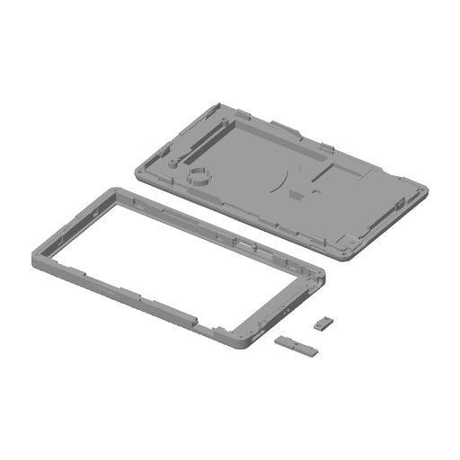
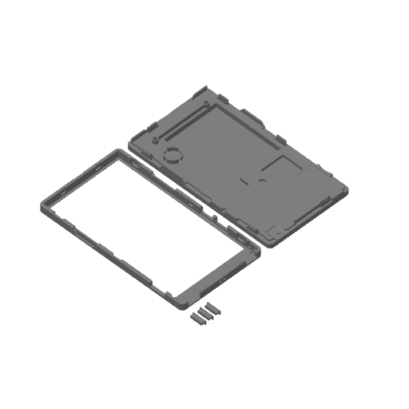

# Hardware

**Languages:** [Español](README.md) · **English** · [简体中文](README.zh-CN.md) · [日本語](README.ja.md)

## v21 case

v21 is the current PaperDIY case. It lives in [`3d/v21/`](3d/v21/) as STL
files, so any slicer can use it. It is slightly larger than the complete-kit
remix (124.4 × 71.4 mm instead of 120 × 67 mm) and replaces the three loose
buttons with a rocker bar for A/B and a lever for button C (power). The back
cover has a recess for a stick-on MagSafe magnetic ring.

| Part | File | Size (mm) |
|---|---|---|
| Back cover (MagSafe recess) | [`PaperDIY_v21_tapa_trasera.stl`](3d/v21/PaperDIY_v21_tapa_trasera.stl) | 124.4 × 71.4 × 8.9 |
| Front frame | [`PaperDIY_v21_marco_frontal_boca_abajo.stl`](3d/v21/PaperDIY_v21_marco_frontal_boca_abajo.stl) | 124.4 × 71.4 × 5.7 |
| A/B rocker bar | [`PaperDIY_v21_barra_basculante_AB.stl`](3d/v21/PaperDIY_v21_barra_basculante_AB.stl) | 22.0 × 5.5 × 1.7 |
| C lever (power) | [`PaperDIY_v21_palanca_C.stl`](3d/v21/PaperDIY_v21_palanca_C.stl) | 5.1 × 9.9 × 1.7 |

- **MagSafe:** annular recess on the outer face of the back cover, Ø 56.4 mm
  outside, Ø 44.6 mm inside and 0.8 mm deep, centred across the width and
  38.4 mm from one end. A stick-on magnetic ring up to those sizes fits; check
  the ring's dimensions before buying one.
- **Orientation:** the parts come oriented for printing. The front frame is
  upside down, with its visible face on the bed.
- **Format:** binary STL in millimetres, no slicer profile.
- **License:** an evolution of the remix of M5Stack's official model; MIT
  (© 2021 M5Stack for the original, © 2026 PaperDIY Reader contributors for
  v21). See [`3d/LICENSE-M5Stack.txt`](3d/LICENSE-M5Stack.txt) and
  [`../LICENSE`](../LICENSE).

## Complete-kit remix (previous version)

[`3d/PaperDIY_kit_completo.3mf`](3d/PaperDIY_kit_completo.3mf) is a modified
version of the official case model for the **M5Stack PaperDIY Complete Kit
(K159-B)**, with the three original buttons. Use it to print the complete kit,
reprint a part or start your own case.

- **Original:** [M5Stack M5_Hardware — K159-B PaperDIY Complete Kit/Structures](https://github.com/m5stack/M5_Hardware/tree/master/Products/K159-B_PaperDIY_Complete_Kit/Structures)
  (`PaperDlY_Complete_Kit.stl`), MIT, © 2021 M5Stack. Full text in
  [`3d/LICENSE-M5Stack.txt`](3d/LICENSE-M5Stack.txt).
- **Remix:** © 2026 PaperDIY Reader contributors, MIT. Distributed under the
  same terms as the rest of the repo; see [`../LICENSE`](../LICENSE).
- **Format:** Bambu Studio project prepared for a Bambu Lab X2D with a 0.4 mm
  nozzle. The geometry can be reused in another slicer.
- **Contents:** back shell, front frame and the three buttons.
- **Preview:** [`3d/PaperDIY_kit_completo_preview.png`](3d/PaperDIY_kit_completo_preview.png).

## Assembly

> **Warning:** the screws are M2 and must be **shorter than 3 mm**. A longer
> screw can touch the screen and break it. This is the same warning M5Stack
> publishes for the original kit.
