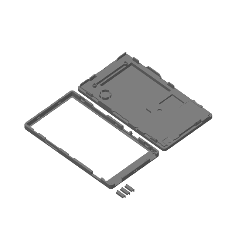

# Hardware

**Languages:** [Español](README.md) · **English** · [简体中文](README.zh-CN.md) · [日本語](README.ja.md)

## 3D case for the PaperDIY Complete Kit

[`3d/PaperDIY_kit_completo.3mf`](3d/PaperDIY_kit_completo.3mf) is a modified
version of the official case model for the **M5Stack PaperDIY Complete Kit
(K159-B)**. It is intended for anyone who wants to print the complete kit,
reprint a part or use it as a starting point for their own case.

- **Original:** [M5Stack M5_Hardware — K159-B PaperDIY Complete Kit/Structures](https://github.com/m5stack/M5_Hardware/tree/master/Products/K159-B_PaperDIY_Complete_Kit/Structures)
  (`PaperDlY_Complete_Kit.stl`), MIT, © 2021 M5Stack. Full text in
  [`3d/LICENSE-M5Stack.txt`](3d/LICENSE-M5Stack.txt).
- **Remix:** © 2026 PaperDIY Reader contributors, MIT. Distributed under the
  same terms as the rest of the repo; see [`../LICENSE`](../LICENSE).
- **Format:** Bambu Studio project prepared for a Bambu Lab X2D with a 0.4 mm
  nozzle. The geometry can be reused in another slicer.
- **Contents:** back shell, front frame and the three buttons.
- **Preview:** [`3d/PaperDIY_kit_completo_preview.png`](3d/PaperDIY_kit_completo_preview.png).

> **Assembly warning:** the screws are M2 and must be **shorter than 3 mm**.
> A longer screw can touch the screen and break it. This is the same warning
> M5Stack publishes for the original kit.
