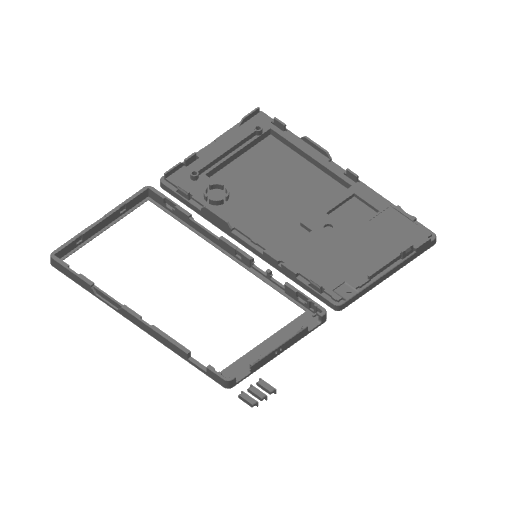

# ハードウェア

**言語：** [Español](README.md) · [English](README.en.md) · [简体中文](README.zh-CN.md) · **日本語**

## PaperDIY Complete Kit の 3D ケース

[`3d/PaperDIY_kit_completo.3mf`](3d/PaperDIY_kit_completo.3mf) は、
**M5Stack PaperDIY Complete Kit（K159-B）** の公式ケースモデルを改造した
ものです。キット全体のプリント、部品の再プリント、オリジナルケース設計の
出発点として使えます。

- **オリジナル：** [M5Stack M5_Hardware — K159-B PaperDIY Complete Kit/Structures](https://github.com/m5stack/M5_Hardware/tree/master/Products/K159-B_PaperDIY_Complete_Kit/Structures)
  （`PaperDlY_Complete_Kit.stl`）、MIT、© 2021 M5Stack。ライセンス全文は
  [`3d/LICENSE-M5Stack.txt`](3d/LICENSE-M5Stack.txt)。
- **改造版：** © 2026 PaperDIY Reader contributors、MIT。リポジトリの他の
  部分と同じ条件で配布します。[`../LICENSE`](../LICENSE) を参照。
- **形式：** Bambu Lab X2D、0.4 mm ノズル向けの Bambu Studio プロジェクト。
  形状は他のスライサーでも再利用できます。
- **内容：** リアシェル、フロントフレーム、3 個のボタン。
- **プレビュー：** [`3d/PaperDIY_kit_completo_preview.png`](3d/PaperDIY_kit_completo_preview.png)。

> **組み立て時の注意：** ネジは M2 で、長さは**3 mm 未満**にしてください。
> 長いネジは画面に接触して破損する恐れがあります。これは M5Stack が純正
> キット向けに公開している注意と同じです。
