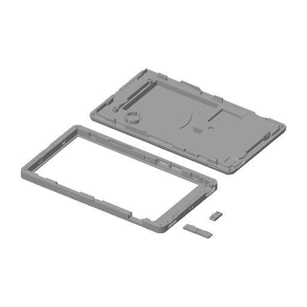
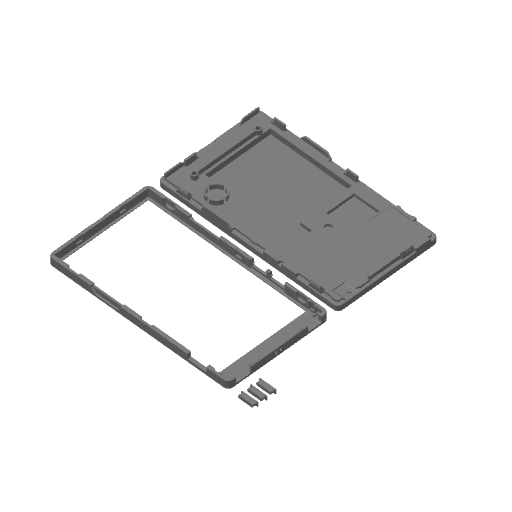

# ハードウェア

**言語：** [Español](README.md) · [English](README.en.md) · [简体中文](README.zh-CN.md) · **日本語**

## v21 ケース

v21 は PaperDIY の現行ケースです。[`3d/v21/`](3d/v21/) に STL で置いて
あるので、どのスライサーでも使えます。Complete Kit 改造版より少し大きく
（120 × 67 mm に対して 124.4 × 71.4 mm）、3 個の独立したボタンを A/B 用の
シーソーバーと C ボタン（電源）用のレバーに置き換えています。リアカバーには
MagSafe 磁気リングを貼るための溝があります。

| 部品 | ファイル | 寸法（mm） |
|---|---|---|
| リアカバー（MagSafe 用の溝） | [`PaperDIY_v21_tapa_trasera.stl`](3d/v21/PaperDIY_v21_tapa_trasera.stl) | 124.4 × 71.4 × 8.9 |
| フロントフレーム | [`PaperDIY_v21_marco_frontal_boca_abajo.stl`](3d/v21/PaperDIY_v21_marco_frontal_boca_abajo.stl) | 124.4 × 71.4 × 5.7 |
| A/B シーソーバー | [`PaperDIY_v21_barra_basculante_AB.stl`](3d/v21/PaperDIY_v21_barra_basculante_AB.stl) | 22.0 × 5.5 × 1.7 |
| C レバー（電源） | [`PaperDIY_v21_palanca_C.stl`](3d/v21/PaperDIY_v21_palanca_C.stl) | 5.1 × 9.9 × 1.7 |

- **MagSafe：** リアカバー外側の環状の溝で、外径 Ø 56.4 mm、内径 Ø 44.6 mm、
  深さ 0.8 mm です。幅方向の中央、一端から 38.4 mm の位置にあります。この
  寸法以内の貼り付け式磁気リングが入ります。購入前にリングの寸法を確認して
  ください。
- **向き：** 各部品はプリント向きに配置済みです。フロントフレームは表面を
  下にして、見える面がベッドに接する向きです。
- **形式：** ミリ単位のバイナリ STL。スライサープロファイルは含みません。
- **ライセンス：** M5Stack 公式モデルの改造版を発展させたもので、MIT
  （オリジナル © 2021 M5Stack、v21 © 2026 PaperDIY Reader contributors）。
  [`3d/LICENSE-M5Stack.txt`](3d/LICENSE-M5Stack.txt) と
  [`../LICENSE`](../LICENSE) を参照。

## Complete Kit 改造版（旧バージョン）

[`3d/PaperDIY_kit_completo.3mf`](3d/PaperDIY_kit_completo.3mf) は、
**M5Stack PaperDIY Complete Kit（K159-B）** の公式ケースモデルを改造した
もので、純正の 3 個のボタンを使います。キット全体のプリント、部品の
再プリント、オリジナルケース設計の出発点として使えます。

- **オリジナル：** [M5Stack M5_Hardware — K159-B PaperDIY Complete Kit/Structures](https://github.com/m5stack/M5_Hardware/tree/master/Products/K159-B_PaperDIY_Complete_Kit/Structures)
  （`PaperDlY_Complete_Kit.stl`）、MIT、© 2021 M5Stack。ライセンス全文は
  [`3d/LICENSE-M5Stack.txt`](3d/LICENSE-M5Stack.txt)。
- **改造版：** © 2026 PaperDIY Reader contributors、MIT。リポジトリの他の
  部分と同じ条件で配布します。[`../LICENSE`](../LICENSE) を参照。
- **形式：** Bambu Lab X2D、0.4 mm ノズル向けの Bambu Studio プロジェクト。
  形状は他のスライサーでも再利用できます。
- **内容：** リアシェル、フロントフレーム、3 個のボタン。
- **プレビュー：** [`3d/PaperDIY_kit_completo_preview.png`](3d/PaperDIY_kit_completo_preview.png)。

## 組み立て

> **注意：** ネジは M2 で、長さは**3 mm 未満**にしてください。長いネジは
> 画面に接触して破損する恐れがあります。これは M5Stack が純正キット向けに
> 公開している注意と同じです。
