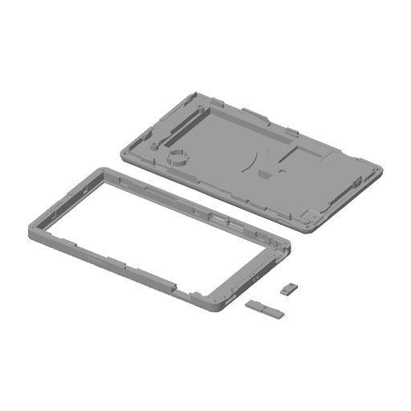
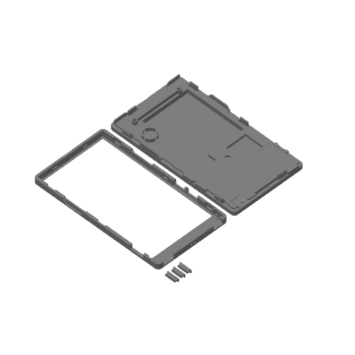

# Hardware

**Idiomas:** **Español** · [English](README.en.md) · [简体中文](README.zh-CN.md) · [日本語](README.ja.md)

## Carcasa v21

La v21 es la versión actual de la carcasa del PaperDIY. Está en
[`3d/v21/`](3d/v21/) como STL, así que sirve para cualquier slicer. Es algo más
grande que el remix del kit completo (124,4 × 71,4 mm frente a 120 × 67 mm) y
cambia los tres botones sueltos por una barra basculante para A/B y una
palanca para el botón C (power).

| Pieza | Fichero | Medidas (mm) |
|---|---|---|
| Tapa trasera | [`PaperDIY_v21_tapa_trasera.stl`](3d/v21/PaperDIY_v21_tapa_trasera.stl) | 124,4 × 71,4 × 8,9 |
| Marco frontal | [`PaperDIY_v21_marco_frontal_boca_abajo.stl`](3d/v21/PaperDIY_v21_marco_frontal_boca_abajo.stl) | 124,4 × 71,4 × 5,7 |
| Barra basculante A/B | [`PaperDIY_v21_barra_basculante_AB.stl`](3d/v21/PaperDIY_v21_barra_basculante_AB.stl) | 22,0 × 5,5 × 1,7 |
| Palanca C (power) | [`PaperDIY_v21_palanca_C.stl`](3d/v21/PaperDIY_v21_palanca_C.stl) | 5,1 × 9,9 × 1,7 |

- **Orientación:** las piezas vienen orientadas para imprimir. El marco
  frontal va boca abajo, con la cara vista sobre la cama.
- **Formato:** STL binario en milímetros, sin perfil de slicer.
- **Licencia:** evolución del remix del modelo oficial de M5Stack; MIT
  (© 2021 M5Stack el original, © 2026 PaperDIY Reader contributors la v21).
  Ver [`3d/LICENSE-M5Stack.txt`](3d/LICENSE-M5Stack.txt) y
  [`../LICENSE`](../LICENSE).

## Remix del kit completo (versión anterior)

[`3d/PaperDIY_kit_completo.3mf`](3d/PaperDIY_kit_completo.3mf) es una
modificación del modelo oficial de la carcasa del **M5Stack PaperDIY Complete
Kit (K159-B)**, con los tres botones originales. Sirve para imprimir el kit
completo, reimprimir una pieza o partir de una base para hacer tu propia
carcasa.

- **Original:** [M5Stack M5_Hardware — K159-B PaperDIY Complete Kit/Structures](https://github.com/m5stack/M5_Hardware/tree/master/Products/K159-B_PaperDIY_Complete_Kit/Structures)
  (`PaperDlY_Complete_Kit.stl`), MIT, © 2021 M5Stack. Texto completo en
  [`3d/LICENSE-M5Stack.txt`](3d/LICENSE-M5Stack.txt).
- **Remix:** © 2026 PaperDIY Reader contributors, MIT. Se distribuye bajo los
  mismos términos que el resto del repo; ver [`../LICENSE`](../LICENSE).
- **Formato:** proyecto de Bambu Studio preparado para Bambu Lab X2D con
  boquilla de 0,4 mm. La geometría se puede reutilizar en otro slicer.
- **Contenido:** carcasa trasera, marco frontal y los tres botones.
- **Vista previa:** [`3d/PaperDIY_kit_completo_preview.png`](3d/PaperDIY_kit_completo_preview.png).

## Montaje

> **Aviso:** los tornillos son M2 y deben medir **menos de 3 mm**. Un
> tornillo más largo puede tocar la pantalla y romperla. Es el mismo aviso que
> publica M5Stack para el kit original.
