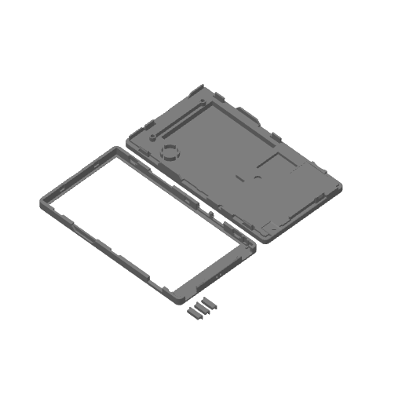

# Hardware

**Idiomas:** **Español** · [English](README.en.md) · [简体中文](README.zh-CN.md) · [日本語](README.ja.md)

## Carcasa 3D del PaperDIY Complete Kit

[`3d/PaperDIY_kit_completo.3mf`](3d/PaperDIY_kit_completo.3mf) es una
modificación del modelo oficial de la carcasa del **M5Stack PaperDIY Complete
Kit (K159-B)**. Está pensada para quien quiera imprimir el kit completo,
reimprimir una pieza o partir de una base para hacer su propia carcasa.

- **Original:** [M5Stack M5_Hardware — K159-B PaperDIY Complete Kit/Structures](https://github.com/m5stack/M5_Hardware/tree/master/Products/K159-B_PaperDIY_Complete_Kit/Structures)
  (`PaperDlY_Complete_Kit.stl`), MIT, © 2021 M5Stack. Texto completo en
  [`3d/LICENSE-M5Stack.txt`](3d/LICENSE-M5Stack.txt).
- **Remix:** © 2026 PaperDIY Reader contributors, MIT. Se distribuye bajo los
  mismos términos que el resto del repo; ver [`../LICENSE`](../LICENSE).
- **Formato:** proyecto de Bambu Studio preparado para Bambu Lab X2D con
  boquilla de 0,4 mm. La geometría se puede reutilizar en otro slicer.
- **Contenido:** carcasa trasera, marco frontal y los tres botones.
- **Vista previa:** [`3d/PaperDIY_kit_completo_preview.png`](3d/PaperDIY_kit_completo_preview.png).

> **Aviso de montaje:** los tornillos son M2 y deben medir **menos de 3 mm**.
> Un tornillo más largo puede tocar la pantalla y romperla. Es el mismo aviso
> que publica M5Stack para el kit original.
