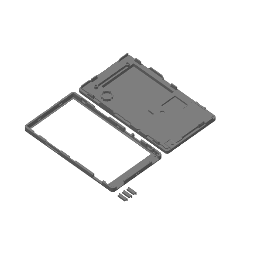

# 硬件

**语言：** [Español](README.md) · [English](README.en.md) · **简体中文** · [日本語](README.ja.md)

## PaperDIY Complete Kit 的 3D 外壳

[`3d/PaperDIY_kit_completo.3mf`](3d/PaperDIY_kit_completo.3mf) 是 **M5Stack
PaperDIY Complete Kit（K159-B）** 官方外壳模型的修改版。适合想打印完整套件、
重新打印某个部件，或以此为基础设计自己外壳的人。

- **原始模型：** [M5Stack M5_Hardware — K159-B PaperDIY Complete Kit/Structures](https://github.com/m5stack/M5_Hardware/tree/master/Products/K159-B_PaperDIY_Complete_Kit/Structures)
  （`PaperDlY_Complete_Kit.stl`），MIT，© 2021 M5Stack。完整许可证见
  [`3d/LICENSE-M5Stack.txt`](3d/LICENSE-M5Stack.txt)。
- **修改版：** © 2026 PaperDIY Reader contributors，MIT。与本仓库其余部分
  采用相同条款；见 [`../LICENSE`](../LICENSE)。
- **格式：** 面向 Bambu Lab X2D、0.4 mm 喷嘴准备的 Bambu Studio 项目。几何
  模型也可以在其他切片软件中复用。
- **内容：** 后壳、前框和三个按键。
- **预览：** [`3d/PaperDIY_kit_completo_preview.png`](3d/PaperDIY_kit_completo_preview.png)。

> **装配警告：** 螺丝为 M2，长度必须**小于 3 mm**。更长的螺丝可能碰到屏幕
> 并将其损坏。这也是 M5Stack 对原始套件发布的警告。
