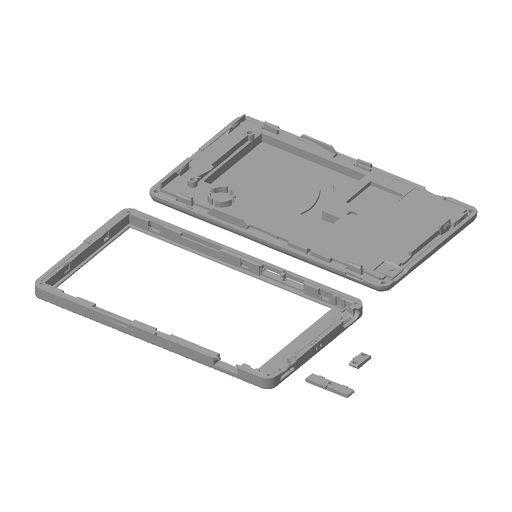
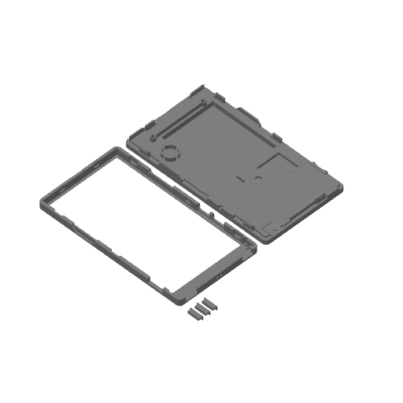

# 硬件

**语言：** [Español](README.md) · [English](README.en.md) · **简体中文** · [日本語](README.ja.md)

## v21 外壳

v21 是 PaperDIY 当前的外壳版本，以 STL 文件形式放在 [`3d/v21/`](3d/v21/)，
任何切片软件都能使用。它比完整套件修改版略大（124.4 × 71.4 mm，原为
120 × 67 mm），并把三个独立按键换成一根用于 A/B 的翘板和一个用于 C 键
（电源）的拨杆。后盖带有一圈凹槽，可粘贴 MagSafe 磁吸环。

| 部件 | 文件 | 尺寸（mm） |
|---|---|---|
| 后盖（MagSafe 凹槽） | [`PaperDIY_v21_tapa_trasera.stl`](3d/v21/PaperDIY_v21_tapa_trasera.stl) | 124.4 × 71.4 × 8.9 |
| 前框 | [`PaperDIY_v21_marco_frontal_boca_abajo.stl`](3d/v21/PaperDIY_v21_marco_frontal_boca_abajo.stl) | 124.4 × 71.4 × 5.7 |
| A/B 翘板 | [`PaperDIY_v21_barra_basculante_AB.stl`](3d/v21/PaperDIY_v21_barra_basculante_AB.stl) | 22.0 × 5.5 × 1.7 |
| C 拨杆（电源） | [`PaperDIY_v21_palanca_C.stl`](3d/v21/PaperDIY_v21_palanca_C.stl) | 5.1 × 9.9 × 1.7 |

- **MagSafe：** 后盖外侧有一圈环形凹槽，外径 Ø 56.4 mm、内径 Ø 44.6 mm、
  深 0.8 mm，宽度方向居中，距一端 38.4 mm。可放入不超过这些尺寸的背胶磁吸环；
  购买前请核对磁吸环尺寸。
- **摆放方向：** 各部件已按打印方向摆好。前框正面朝下，外观面贴在热床上。
- **格式：** 二进制 STL，单位为毫米，不含切片配置。
- **许可：** 基于 M5Stack 官方模型修改版继续演进；MIT（原始模型 © 2021
  M5Stack；v21 © 2026 PaperDIY Reader contributors）。见
  [`3d/LICENSE-M5Stack.txt`](3d/LICENSE-M5Stack.txt) 和 [`../LICENSE`](../LICENSE)。

## 完整套件修改版（旧版本）

[`3d/PaperDIY_kit_completo.3mf`](3d/PaperDIY_kit_completo.3mf) 是 **M5Stack
PaperDIY Complete Kit（K159-B）** 官方外壳模型的修改版，保留三个原装按键。
适合打印完整套件、重新打印某个部件，或以此为基础设计自己的外壳。

- **原始模型：** [M5Stack M5_Hardware — K159-B PaperDIY Complete Kit/Structures](https://github.com/m5stack/M5_Hardware/tree/master/Products/K159-B_PaperDIY_Complete_Kit/Structures)
  （`PaperDlY_Complete_Kit.stl`），MIT，© 2021 M5Stack。完整许可证见
  [`3d/LICENSE-M5Stack.txt`](3d/LICENSE-M5Stack.txt)。
- **修改版：** © 2026 PaperDIY Reader contributors，MIT。与本仓库其余部分
  采用相同条款；见 [`../LICENSE`](../LICENSE)。
- **格式：** 面向 Bambu Lab X2D、0.4 mm 喷嘴准备的 Bambu Studio 项目。几何
  模型也可以在其他切片软件中复用。
- **内容：** 后壳、前框和三个按键。
- **预览：** [`3d/PaperDIY_kit_completo_preview.png`](3d/PaperDIY_kit_completo_preview.png)。

## 装配

> **警告：** 螺丝为 M2，长度必须**小于 3 mm**。更长的螺丝可能碰到屏幕
> 并将其损坏。这也是 M5Stack 对原始套件发布的警告。
